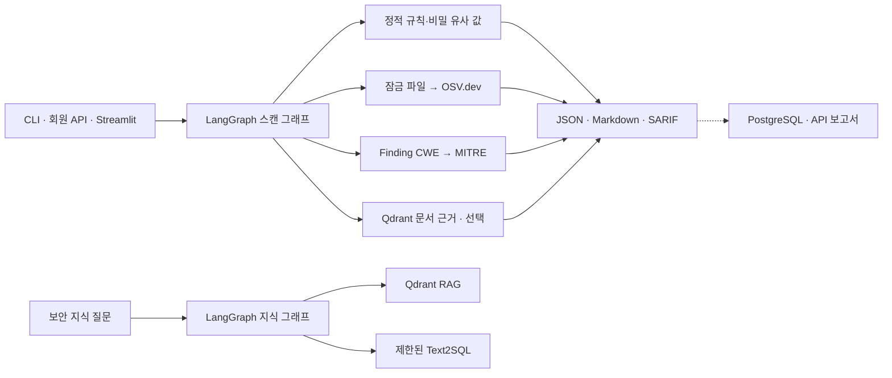

# SecRAGraph

[](https://github.com/taehyeon-git/SecRAGraph/actions/workflows/ci.yml) · [Code Scanning](https://github.com/taehyeon-git/SecRAGraph/security/code-scanning) · [아키텍처](docs/architecture.md) · [데모 절차](docs/demo.md)

**코드를 실행하지 않고 검사한 뒤, 탐지 결과를 근거와 함께 보고하는 백엔드·DevSecOps 포트폴리오 프로젝트입니다.** 정적 규칙과 OSV.dev로 문제를 찾고, LangGraph가 스캔과 지식 질의의 흐름을 조정합니다. FastAPI 회원 API, CLI, Streamlit 데모와 GitHub Actions가 같은 분석 엔진을 사용합니다.

## 문제 정의

보안 경고는 어디서 무엇을 발견했는지, 어떤 자료를 근거로 설명하는지 확인할 수 있어야 합니다. SecRAGraph는 파일·ZIP·로컬 디렉터리의 지원 텍스트를 읽어 finding을 만들고, JSON·Markdown·SARIF 보고서로 제공합니다. 대상 코드는 실행하거나 import하지 않습니다.

[예제 파일](examples/insecure/sample.py)을 스캔하면 비밀 유사 값, `shell=True`, `eval`을 찾습니다. 아래는 실제 JSON 보고서의 finding 한 건을 발췌한 것입니다. 소스 줄과 비밀 원문은 보고서에 넣지 않습니다.

```json
{
  "rule_id": "SEC001",
  "file_path": "sample.py",
  "line_start": 5,
  "redacted_evidence": "Secret-like assignment detected: ***REDACTED***; source omitted for privacy."
}
```

## 시작 및 구동

Python 3.11 이상, `uv`, Docker Desktop Linux 엔진 또는 Linux Docker 엔진을 준비하고 저장소 루트에서 실행합니다.

```text
uv run --frozen python -m scripts.local_up
```

이 명령 하나가 평가 사례에 필요한 공식 CWE 자료 준비, 스캐너·RAG 평가, Compose 빌드, DB 마이그레이션, 서비스 준비와 최초 회원 생성을 진행합니다. 이후 실제 스캔 결과나 새 질문에 다른 CWE가 필요하면 해당 공식 항목을 추가로 확인합니다. 준비가 끝나면 `http://127.0.0.1:8501`에서 회원으로 로그인하거나 `http://127.0.0.1:8000/docs`에서 API 계약을 확인할 수 있습니다. 두 서비스는 로컬 루프백에만 열립니다. 재실행·종료·복구는 [운영 문서](docs/operations.md)에 있습니다.

CLI에서는 같은 스캔 엔진을 바로 사용할 수 있습니다.

```powershell
uv run security-review scan examples/insecure/sample.py --format markdown
uv run security-review scan examples/insecure/sample.py --format sarif --output build/sample.sarif
```

정적 스캔에는 모델 키가 필요하지 않습니다. 실제 모델 기반 RAG·Text2SQL 답변에는 제공자 키가 필요하며, 설정과 데이터 전송 범위는 [운영 문서](docs/operations.md)를 참고하세요.

## 핵심 아키텍처



회원 API는 스캔 보고서를 PostgreSQL에 저장하고 본인 보고서만 다시 볼 수 있게 합니다. CLI는 DB 없이 로컬에서 스캔할 수 있습니다. [아키텍처 문서](docs/architecture.md)에 그래프 노드, 저장 경계와 실패 처리가 있습니다.

## LangGraph 워크플로

- **스캔:** 입력 검증 → 결정적 규칙 탐지 → OSV·CWE 근거 준비 → 위험도 산정 → 보고서 생성. 외부 조회가 실패해도 확인된 finding은 유지하고 검사 범위 경고를 남깁니다.
- **지식 질의:** 질문 분류 → 필요한 CWE 확인 → Qdrant 검색 → 근거 평가 → 질문 재작성·재검색 또는 인용 답변·보류. Text2SQL 질문은 별도 제한된 읽기 경로로 처리합니다.

스캔의 탐지와 수정 권고는 정적 규칙으로 재현됩니다. RAG 문서는 출처를 보강하고 지식 질의에 사용됩니다.

## RAG와 Text2SQL

| 기능 | 동작과 경계 |
| --- | --- |
| **CWE 근거·RAG** | finding 또는 질문에서 필요한 CWE를 확인해 공식 MITRE 항목을 수집합니다. 임베딩 제공자가 설정되면 검증된 문서를 Qdrant에서도 검색합니다. 새 PDF를 자동으로 찾거나 다운로드하지 않습니다. |
| **Text2SQL** | 모델이 만든 SQL을 SQLGlot AST로 검사한 뒤 `intel.cwe`·`intel.cve`의 제한된 읽기 전용 질의만 실행합니다. [제어 방식](docs/text2sql-security.md)을 참고하세요. |

동봉된 [CWE/CVE CSV](data/samples/README.md)는 데모용 합성 자료입니다. RAG 워크플로의 고정 질문 4건은 동봉 지침과 결정적 응답 어댑터로 4/4 경로를 검증했습니다. 이는 검색·인용 계약의 재현 시험이며 실제 LLM 답변의 사실성 점수는 아닙니다. [질문·인용·재현 절차](docs/demo.md)와 [별도 PDF 수집 절차](docs/official-corpus.md)를 참고하세요.

## 패키지 취약점 조회

스캔은 `uv.lock` 및 npm `package-lock.json` v2/v3에서 정확한 패키지명·버전을 추출해 OSV.dev에 조회합니다. 조회된 권고만 출처와 함께 의존성 finding으로 기록합니다. 패키지명·버전은 OSV에 전송되며, 조회 실패나 지원하지 않는 잠금 항목은 범위 경고로 남습니다. 빈 결과는 안전을 증명하지 않습니다. [지원 범위와 전송 정보](docs/osv.md)를 참고하세요.

## 스캐너 평가

현재 회귀 자료는 [120개 합성 사례](data/evaluation/scanner_cases.json)입니다. 기존 53개에 67개를 더해 8개 규칙의 양성·정상 대조군, 별칭, 주석, 중첩 경로, 복수 라벨과 문법 오류를 검사합니다. 로컬 스캔과 회원 로그인 API에 **같은 사례**를 입력해 결과와 저장된 보고서를 대조했습니다.

| 평가 경로 | 처리·확인 | TP / FP / FN | 적격 정상 사례 오경보 |
| --- | --- | ---: | ---: |
| 로컬 직접 스캔 | 120/120 사례 스캔 | 69 / 0 / 0 | 0/55 |
| 회원 로그인 API | 120/120 ZIP 업로드·저장 보고서 대조 | 69 / 0 / 0 | 0/55 |

두 경로의 정밀도·재현율·F1은 각각 1.000이었고, API에서 finding 상대 경로 69건과 무인증 401·타 회원 404·폐기 세션 401을 확인했습니다. 예상된 Python 문법 진단은 2건, 예상 밖·누락 진단은 0건입니다. TP는 위험 함수 호출 수가 아닌 `(사례 ID, 규칙 ID, 시작 줄)` 라벨 수입니다. 평가 때는 외부 CWE·OSV 조회와 모델 호출을 껐습니다.

```powershell
uv run --frozen python -m scripts.run_scanner_benchmark
uv run --frozen python -m scripts.run_authenticated_scanner_benchmark
```

두 번째 명령에는 Docker가 필요합니다. 결과 파일, 입력 SHA-256, 분모와 이전 39·53건 기록은 [확장 평가 증거](docs/evidence/expanded-scanner-2026-10-27.md)와 [데모 절차](docs/demo.md#11-합성-스캐너-벤치마크)에 있습니다. 이 1.000은 **작성자가 만든 합성 회귀 사례의 정확 일치 결과**이며 임의 저장소의 탐지율을 나타내지 않습니다.

별도 [OWASP BenchmarkPython 도전](docs/demo.md#22-외부-스캐너-코퍼스-도전)은 지원 CWE-78·89·502 중 스캔 완료한 82개 사례에서 TP=27, FP=18, FN=6, TN=31이었습니다. 이는 다른 라벨·분모와 제한된 sink 범위를 사용하므로 위 합성 평가와 합산하거나 직접 비교하지 않습니다.

## 테스트와 CI

[CI](.github/workflows/ci.yml)는 Ruff·mypy·pytest·Bandit, RAG·스캐너 회귀 평가, 의존성 감사, 이미지 빌드와 Compose 스모크를 실행합니다. [보안 셀프 스캔](.github/workflows/security-scan.yml)은 `src`의 SARIF를 검증하고 권한이 허용되면 Code Scanning에 업로드합니다. 신뢰된 `main` 실행에서만 동봉 합성 입력의 평가 증거를 아티팩트로 게시합니다.

서비스 없이 문서·CLI 검사를 실행하려면 다음 명령을 사용합니다.

```powershell
uv run pytest tests/unit/docs/test_documentation.py tests/e2e/test_cli.py
```

전체 통합 테스트에는 [전용 Compose](tests/compose.integration.yaml)의 PostgreSQL `127.0.0.1:55432`, Qdrant `127.0.0.1:56333`이 필요합니다. 일부 테스트는 실행 중인 API를 `SECRAGRAPH_TEST_API_URL`로 지정해야 합니다. [테스트 실행 방법](docs/demo.md)과 [현재 GitHub Actions](https://github.com/taehyeon-git/SecRAGraph/actions)를 확인하세요.

## 한계

- 정적 규칙은 지원하는 언어·패턴만 검사합니다. 탐지 결과만으로 실제 악용 가능성을 확정할 수 없으며 전문 SAST·비밀 탐지기·침투 시험을 대체하지 않습니다.
- 회원 로그인과 보고서 소유권은 로컬 배포를 위한 기능입니다. 공개 서비스용 속도 제한·MFA·계정 복구가 없어 인터넷에 그대로 배포할 수 없습니다.
- OSV 조회는 명시된 패키지 버전에 한정됩니다. 보고서의 파일 경로·대상 이름·인용 메타데이터는 민감할 수 있습니다. 모델 답변은 오류나 프롬프트 인젝션 영향을 받을 수 있고, 문서 근거의 품질은 수집 자료에 좌우됩니다. [위협 모델](docs/threat-model.md)에 신뢰 경계와 남은 위험을 기록했습니다.

## 출처와 기여

이 프로젝트는 팀 교육 프로젝트 `rag-documents`와 `security-agent-langgraph`에서 배운 접근을 독립적으로 통합한 작업입니다. 팀 전체 결과를 개인 단독 성과로 표시하지 않습니다. 직접 기여, 기존 프로젝트와 새 구현의 경계 및 자료 권리는 [출처와 크레딧](docs/origins-and-credits.md)에 기록했습니다. [MIT 라이선스](LICENSE)는 새로 작성한 SecRAGraph 코드에만 적용됩니다.
