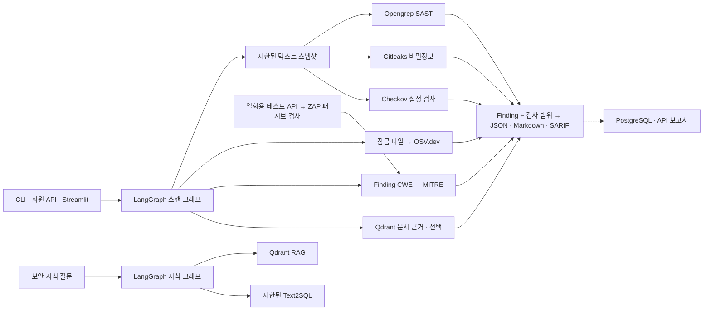

# SecRAGraph

[](https://github.com/taehyeon-git/SecRAGraph/actions/workflows/ci.yml) · [Code Scanning](https://github.com/taehyeon-git/SecRAGraph/security/code-scanning) · [아키텍처](docs/architecture.md) · [데모 절차](docs/demo.md)

**로그인한 사용자가 소스 파일이나 ZIP을 제출하면 여러 보안 검사기의 결과를 하나의 근거 있는 보고서로 정리하는 백엔드·DevSecOps 포트폴리오입니다.** 별도의 DAST 경로는 격리된 일회용 테스트 API를 실행해 HTTP 응답을 검사합니다. LangGraph가 검사 결과의 CWE 근거 검색과 위험도 계산을 조정합니다. FastAPI와 CLI는 소스 스캔 경로를 공유하고 Streamlit은 로컬 데모 화면입니다.

## 문제 정의

보안 경고의 개수만으로는 검사를 신뢰하기 어렵습니다. 어떤 파일을 어떤 검사기가 받았는지, 실행이 성공했는지, 근거가 무엇인지 함께 보여줘야 합니다. SecRAGraph는 파일·ZIP·로컬 디렉터리의 지원 텍스트를 읽어 `Finding`과 검사별 실행 기록을 만들고 JSON·Markdown·SARIF 보고서로 제공합니다. 제출 코드는 실행하거나 import하지 않습니다.

아래는 실제 Opengrep 탐지에서 반환한 필드의 예입니다. 소스 줄과 비밀 원문은 보고서에 넣지 않습니다.

```json
{
  "engine": "opengrep",
  "rule_id": "OG/python_eval_rule-eval",
  "file_path": "app.py",
  "line_start": 1,
  "redacted_evidence": "[source omitted]"
}
```

비밀정보는 Gitleaks가 전담하며 원문을 가립니다. 검사 상태(`completed`, `partial`, `skipped`, `not_run`, `error`), 대상 파일, 확인된 검사 파일, 도구 버전과 소요 시간도 보고합니다. Gitleaks는 전체 파일별 검사 목록을 반환하지 않으므로 제출 파일과 탐지가 확인된 경로를 구분합니다.

## 시작 및 구동

Python 3.11 이상, `uv`, Linux Docker 엔진을 준비하고 저장소 루트에서 실행합니다.

```text
uv run --frozen python -m scripts.local_up
```

이 명령 하나가 공식 CWE 초기 자료와 RAG 평가, Compose 이미지, DB 마이그레이션, 서비스 준비와 최초 회원 생성을 진행합니다. 실제 finding이나 새 질문에 다른 CWE가 필요하면 그 항목을 추가로 확인합니다. 준비 후 `http://127.0.0.1:8501`에서 로그인하거나 `http://127.0.0.1:8000/docs`에서 API 계약을 확인할 수 있습니다. 두 서비스는 로컬 루프백에만 열립니다. 재실행·종료·복구는 [운영 문서](docs/operations.md)에 있습니다.

CLI도 같은 스캔 경로를 사용합니다. 호스트에서 직접 실행할 때는 Opengrep·Gitleaks·Checkov 바이너리를 별도로 준비해야 하며, 없는 엔진은 보고서에서 `not_run`으로 표시됩니다.

```powershell
uv run security-review scan examples/insecure/sample.py --format markdown
uv run security-review scan examples/insecure/sample.py --format sarif --output build/sample.sarif
```

코드 검사에는 모델 키가 필요하지 않습니다. 실제 모델 기반 RAG·Text2SQL 답변에는 제공자 키가 필요하며, 설정과 데이터 전송 범위는 [운영 문서](docs/operations.md)를 참고하세요.

## 핵심 아키텍처



회원 API는 스캔 보고서를 PostgreSQL에 저장하고 본인 보고서만 다시 볼 수 있게 합니다. CLI는 DB 없이 로컬에서 스캔할 수 있습니다. [아키텍처 문서](docs/architecture.md)에 그래프 노드, 저장 경계와 실패 처리가 있습니다.

| 구분 | 검사와 범위 |
| --- | --- |
| **소스 SAST** | Opengrep 1.32.0, [출처·해시가 고정된 MIT 규칙 79개](data/engines/opengrep/README.md), [프로젝트 taint 규칙 3개](data/engines/secragraph-taint/README.md). Python·JavaScript/TypeScript의 규칙 패턴과 웹 입력→명령 실행/SQL 쿼리 흐름을 같은 파일의 함수 사이까지 검사합니다. |
| **비밀정보** | Gitleaks 8.30.1. `.env.local`, `.npmrc`, 키 파일을 포함한 허용 텍스트에서 비밀 유사 값을 검사하고 값을 가립니다. |
| **설정 오류** | Checkov 3.3.30. 지원 Terraform·구성 파일을 검사하며 [간접 의존성도 해시로 고정](infra/scanners/checkov-requirements.txt)합니다. |
| **패키지 권고** | `uv.lock`·npm `package-lock.json`의 정확한 버전을 OSV.dev에서 확인합니다. 코드나 잠금 파일 원문은 전송하지 않습니다. |
| **테스트 API DAST** | `io.secragraph.dast.disposable=true`가 붙은 실행 중인 Docker 컨테이너만 ZAP의 패시브 검사 모드로 확인합니다. 내부 전용 네트워크에서 인증된 GET 요청과 응답 보안 헤더를 검사하고 HTTP 경로를 별도 위치로 보고합니다. [격리 데모와 검증 절차](docs/demo.md#7-격리-테스트-api-dast)를 참고하세요. |
| **공개 저장소 자체** | [GitHub Actions의 CodeQL `security-extended`](.github/workflows/security-scan.yml)를 사용합니다. 별도 [FastAPI 흐름 픽스처 쿼리](codeql/FastApiCrossFileFlow.ql)는 파일을 넘나드는 추적·차단 모델의 테스트이며 실제 코드 경고 규칙은 아닙니다. 무료 CodeQL 허용 범위인 공개 코드에만 적용합니다. |

회원이 업로드한 비공개 코드는 CodeQL로 검사하지 않습니다. 업로드 코드의 Opengrep 흐름 추적은 **파일 내부의 함수 간** 범위이고 확인한 source·중간 단계·sink 위치를 소스 내용 없이 기록합니다. CodeQL의 여러 파일을 가로지르는 흐름 검사는 이 공개 저장소에 적용합니다. 검사기 실행 실패나 지원하지 않는 언어는 성공으로 숨기지 않고 범위 기록에 남깁니다.

## LangGraph 워크플로

- **스캔:** 입력 검증 → 제한된 스냅샷 → SAST·비밀정보·설정 검사 → OSV 감사 → 실제 finding에 필요한 CWE 수집 → 근거 검색 → 위험도·보고서 생성. 외부 조회가 실패해도 확인한 finding과 범위 경고는 유지합니다.
- **지식 질의:** 질문 분류 → 필요한 CWE 확인 → Qdrant 검색 → 근거 평가 → 질문 재작성·재검색 또는 인용 답변·보류. Text2SQL 질문은 별도 제한된 읽기 경로로 처리합니다.

탐지 엔진과 RAG의 역할은 분리되어 있습니다. RAG는 취약점 여부를 확정하지 않고 finding 설명에 출처를 보강합니다.

## RAG와 Text2SQL

| 기능 | 동작과 경계 |
| --- | --- |
| **CWE 근거·RAG** | finding 또는 질문에서 필요한 CWE를 확인해 공식 MITRE 항목을 수집합니다. 임베딩 제공자가 설정되면 검증된 문서를 Qdrant에서도 검색합니다. 새 PDF를 자동으로 찾거나 다운로드하지 않습니다. |
| **Text2SQL** | 모델이 만든 SQL을 SQLGlot AST로 검사한 뒤 `intel.cwe`·`intel.cve`의 제한된 읽기 전용 질의만 실행합니다. [제어 방식](docs/text2sql-security.md)을 참고하세요. |

동봉된 [CWE/CVE CSV](data/samples/README.md)는 데모용 합성 자료입니다. RAG 평가 질문은 검색·인용 계약의 재현 시험이며 실제 LLM 답변의 사실성 점수가 아닙니다. [질문·인용·재현 절차](docs/demo.md)와 [별도 PDF 수집 절차](docs/official-corpus.md)를 참고하세요.

## 패키지 취약점 조회

스캔은 `uv.lock` 및 npm `package-lock.json` v2/v3에서 정확한 패키지명·버전을 추출해 OSV.dev에 조회합니다. 조회된 권고만 출처와 함께 의존성 finding으로 기록합니다. 패키지명·버전은 OSV에 전송되며, 조회 실패나 지원하지 않는 잠금 항목은 범위 경고로 남습니다. 빈 결과는 안전을 증명하지 않습니다. [지원 범위와 전송 정보](docs/osv.md)를 참고하세요.

## 스캐너 평가

현재 [다중 엔진 사례 manifest](data/evaluation/multiengine_cases.json)는 취약·정상 파일과 웹 입력의 함수 간 흐름을 함께 기록합니다. 고정 Docker 이미지에서 14/14 사례, 42/42 라벨을 평가해 **TP=26, FP=1, FN=1**이었습니다(정밀도·재현율·F1 각각 약 0.963). Flask 헤더 입력을 포함한 4개 taint 흐름의 source·중간 단계·sink 위치가 모두 확인됐고, 라벨 밖 finding은 0건이었습니다. 기존 패턴 규칙은 숫자 변환으로 안전해진 셸 인자를 한 번 잘못 경고했으며 SQL f-string 한 건을 놓쳤습니다. 입력 SHA-256은 `682c1c180ed5e8e20c6fc937bc919f8d3bef5da3af35328800496134f3624152`입니다. **이 수치는 작성자가 만든 회귀 사례의 결과이며 실제 저장소 탐지율이 아닙니다.** 규칙별 수치와 분모는 [고정 평가 증거](docs/evidence/multiengine-scanner-2026-10-27.md)에 있습니다.

별도 [OWASP BenchmarkPython 90개 사례](docs/evidence/multiengine-external-2026-10-27.md)는 넓은 CWE 단위로 **TP 27, FP 19, FN 9, TN 35**였고, 고정 [Starlette 저장소](docs/evidence/multiengine-external-2026-10-27.md#pinned-real-repository-workload)는 라벨이 없어 실행 범위·시간과 미판정 finding만 기록했습니다. 서로 다른 라벨·분모의 점수는 합산하지 않습니다. [평가 방법](docs/demo.md)을 참고하세요.

과거 자체 규칙 8개의 120건 평가와 OWASP 도전 기록은 [역사적 증거](docs/evidence/expanded-scanner-2026-10-27.md)로 보존합니다. 그 규칙과 평가 스크립트는 현재 스캔 경로에서 제거했으므로 과거 100% 수치를 현재 엔진 성능으로 표시하지 않습니다.

## 테스트와 CI

[CI](.github/workflows/ci.yml)는 Ruff·mypy·pytest·Bandit, RAG 평가, 도구가 설치된 격리 Docker 이미지의 다중 엔진 회귀 평가, 이미지 빌드, Compose 스모크와 일회용 API의 패시브 DAST를 실행합니다. DAST 작업은 보호된 경로에 인증 요청이 도달했는지, 예상 보안 헤더 경고가 있는지 확인하고 정규화한 JSON·Markdown·SARIF만 아티팩트로 보관합니다. 공개 저장소의 [CodeQL 워크플로](.github/workflows/security-scan.yml)는 `security-extended`를 실행합니다. 회원 API 통합 테스트는 로그인→업로드→저장 보고서→소유자 접근을 확인합니다.

서비스 없이 문서·CLI 검사를 실행하려면 다음 명령을 사용합니다.

```powershell
uv run pytest tests/unit/docs/test_documentation.py tests/e2e/test_cli.py
```

전체 통합 테스트에는 [전용 Compose](tests/compose.integration.yaml)의 PostgreSQL `127.0.0.1:55432`, Qdrant `127.0.0.1:56333`이 필요합니다. 일부 테스트는 실행 중인 API를 `SECRAGRAPH_TEST_API_URL`로 지정해야 합니다. [테스트 실행 방법](docs/demo.md)과 [현재 GitHub Actions](https://github.com/taehyeon-git/SecRAGraph/actions)를 확인하세요.

## 한계

- 업로드 코드의 SAST는 지원 규칙·언어·파일 내부 흐름에 한정됩니다. 다른 파일을 지나는 흐름이나 실제 악용 가능성은 별도 검토가 필요합니다. `security-extended`는 기본 CodeQL보다 오경보가 늘 수 있습니다.
- Gitleaks는 검사 완료 시에도 파일별 검증 목록을 제공하지 않습니다. 제출 파일 수를 실제 파일별 검사 성공의 증거로 해석하지 않습니다.
- 회원 로그인과 보고서 소유권은 로컬 배포를 위한 기능입니다. 공개 서비스용 속도 제한·MFA·계정 복구가 없어 인터넷에 그대로 배포할 수 없습니다.
- OSV 조회는 명시된 패키지 버전에 한정됩니다. 보고서의 파일 경로·대상 이름·인용 메타데이터는 민감할 수 있습니다. 모델 답변은 오류나 프롬프트 인젝션 영향을 받을 수 있고, 문서 근거의 품질은 수집 자료에 좌우됩니다. [위협 모델](docs/threat-model.md)에 신뢰 경계와 남은 위험을 기록했습니다.
- 외부 검사기는 현재 API 컨테이너와 같은 네트워크 네임스페이스에서 실행됩니다. 프록시·다운로드 금지 설정을 완전한 네트워크 격리로 간주하지 않습니다.
- 현재 DAST는 승인 표시가 있는 일회용 Docker 테스트 API의 제한된 GET/HEAD/OPTIONS와 패시브 응답 검사를 보여줍니다. 임의 운영 URL이나 업로드한 코드를 실행하지 않으며 SQL 주입 같은 능동 취약점 검증을 주장하지 않습니다. DAST SARIF의 위치는 HTTP 경로이므로 GitHub Code Scanning의 소스 줄 주석으로 올리지 않습니다.

## 출처와 기여

이 프로젝트는 팀 교육 프로젝트 `rag-documents`와 `security-agent-langgraph`에서 배운 접근을 독립적으로 통합한 작업입니다. 팀 전체 결과를 개인 단독 성과로 표시하지 않습니다. 직접 기여, 기존 프로젝트와 새 구현의 경계 및 자료 권리는 [출처와 크레딧](docs/origins-and-credits.md)에 기록했습니다. [MIT 라이선스](LICENSE)는 새로 작성한 SecRAGraph 코드에만 적용됩니다.
