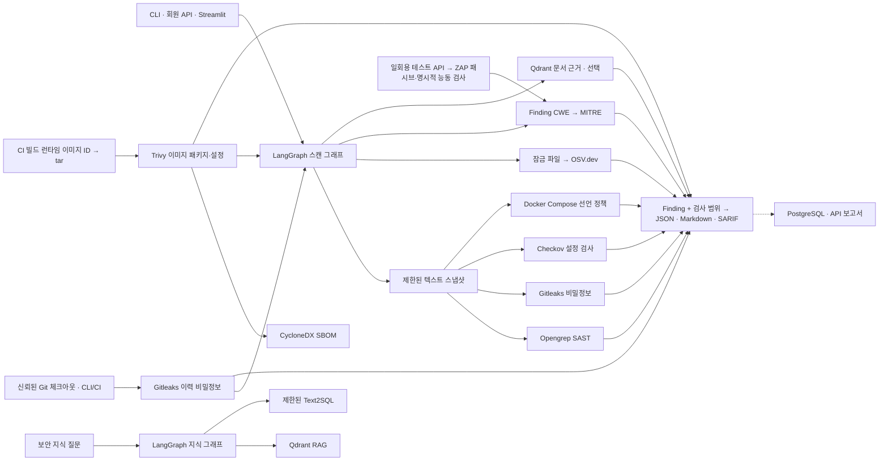

# SecRAGraph

[](https://github.com/taehyeon-git/SecRAGraph/actions/workflows/ci.yml) · [Code Scanning](https://github.com/taehyeon-git/SecRAGraph/security/code-scanning) · [아키텍처](docs/architecture.md) · [데모 절차](docs/demo.md)

**로그인한 사용자가 소스 파일이나 ZIP을 제출하면 여러 보안 검사기의 결과를 하나의 근거 있는 보고서로 정리하는 백엔드·DevSecOps 포트폴리오입니다.** 별도의 DAST 경로는 격리된 일회용 테스트 API의 응답을 검사하고, 명시적으로 허용한 경우 능동 취약점 요청도 수행합니다. 신뢰된 로컬 Git 체크아웃은 독립된 CLI·CI 경로에서 과거 커밋의 비밀정보도 검사합니다. CI가 빌드한 SecRAGraph 런타임 이미지는 별도 Trivy 검사와 CycloneDX SBOM으로 배포 구성요소를 확인합니다. LangGraph가 검사 결과의 근거 검색과 위험도 계산을 조정합니다. FastAPI와 CLI는 소스 스캔 경로를 공유하고 Streamlit은 로컬 데모 화면입니다.

## 문제 정의

보안 경고의 개수만으로는 검사를 신뢰하기 어렵습니다. 어떤 파일을 어떤 검사기가 받았는지, 실행이 성공했는지, 근거가 무엇인지 함께 보여줘야 합니다. SecRAGraph는 파일·ZIP·로컬 디렉터리의 지원 텍스트를 읽어 `Finding`과 검사별 실행 기록을 만들고 JSON·Markdown·SARIF 보고서로 제공합니다. 제출 코드는 실행하거나 import하지 않습니다.

아래는 실제 Opengrep 탐지에서 반환한 필드의 예입니다. 소스 줄과 비밀 원문은 보고서에 넣지 않습니다.

```json
{
  "engine": "opengrep",
  "rule_id": "OG/python_eval_rule-eval",
  "file_path": "app.py",
  "line_start": 1,
  "redacted_evidence": "[source omitted]"
}
```

비밀정보는 Gitleaks가 전담하며 원문을 가립니다. 검사 상태(`completed`, `partial`, `skipped`, `not_run`, `error`), 대상 파일, 확인된 검사 파일, 도구 버전과 소요 시간도 보고합니다. Gitleaks는 전체 파일별 검사 목록을 반환하지 않으므로 제출 파일과 탐지가 확인된 경로를 구분합니다.

## 시작 및 구동

Python 3.11 이상, `uv`, Linux Docker 엔진을 준비하고 저장소 루트에서 실행합니다.

```text
uv run --frozen python -m scripts.local_up
```

이 명령 하나가 공식 CWE 초기 자료와 RAG 평가, Compose 이미지, DB 마이그레이션, 서비스 준비와 최초 회원 생성을 진행합니다. 실제 finding이나 새 질문에 다른 CWE가 필요하면 그 항목을 추가로 확인합니다. 준비 후 `http://127.0.0.1:8501`에서 로그인하거나 `http://127.0.0.1:8000/docs`에서 API 계약을 확인할 수 있습니다. 두 서비스는 로컬 루프백에만 열립니다. 재실행·종료·복구는 [운영 문서](docs/operations.md)에 있습니다.

CLI도 같은 스캔 경로를 사용합니다. 호스트에서 직접 실행할 때는 Opengrep·Gitleaks·Checkov 바이너리를 별도로 준비해야 하며, 없는 엔진은 보고서에서 `not_run`으로 표시됩니다. Docker Compose 정책 검사는 별도 실행 파일 없이 동일한 스냅샷을 읽습니다.

```powershell
uv run security-review scan examples/insecure/sample.py --format markdown
uv run security-review scan examples/insecure/sample.py --format sarif --output build/sample.sarif
uv run security-review scan-history . --format markdown
```

`scan-history`는 호스트에 Gitleaks 8.30.1이 있어야 하며, 기본값은 현재 HEAD에서 도달 가능한 전체 커밋입니다. `--base <전체 SHA> --head <전체 SHA>`로 선택 범위를 줄일 수 있습니다. 찾은 비밀이나 검사가 완료되지 않은 경우 종료 코드는 0이 아닙니다. 회원 업로드·ZIP·REST API는 Git 이력을 받지 않습니다.

이미지 검사와 SBOM은 [CI](.github/workflows/ci.yml)가 런타임 이미지를 빌드한 직후 자동 실행합니다. 로컬 재현은 신뢰된 이미지 tar, Docker의 정확한 로컬 이미지 ID, Trivy 0.76.1과 최신 취약점 DB가 필요합니다. 명령과 검증 기준은 [컨테이너 증거 문서](docs/evidence/container-image-2026-10-30.md)에 있습니다. 회원 업로드는 이미지 빌드·검사를 요청할 수 없으며, `scan-image`도 저장소에서 임의 Dockerfile을 실행하거나 레지스트리 이미지를 가져오지 않습니다.

코드 검사에는 모델 키가 필요하지 않습니다. 실제 모델 기반 RAG·Text2SQL 답변에는 제공자 키가 필요하며, 설정과 데이터 전송 범위는 [운영 문서](docs/operations.md)를 참고하세요.

## 핵심 아키텍처



회원 API는 스캔 보고서를 PostgreSQL에 저장하고 본인 보고서만 다시 볼 수 있게 합니다. CLI는 DB 없이 로컬에서 스캔할 수 있습니다. [아키텍처 문서](docs/architecture.md)에 그래프 노드, 저장 경계와 실패 처리가 있습니다.

| 구분 | 검사와 범위 |
| --- | --- |
| **소스 SAST** | Opengrep 1.32.0, [출처·해시가 고정된 MIT 규칙 79개](data/engines/opengrep/README.md), [프로젝트 taint 규칙 3개](data/engines/secragraph-taint/README.md). Python·JavaScript/TypeScript의 규칙 패턴과 웹 입력→명령 실행/SQL 쿼리 흐름을 같은 파일의 함수 사이까지 검사합니다. |
| **비밀정보** | Gitleaks 8.30.1. `.env.local`, `.npmrc`, 키 파일을 포함한 허용 텍스트에서 비밀 유사 값을 검사하고 값을 가립니다. |
| **Git 이력 비밀정보** | 신뢰된 로컬/CI 체크아웃의 선택된 커밋을 Gitleaks 8.30.1 Git 모드로 검사합니다. 보고서에는 비밀 원문 대신 과거 커밋 SHA·파일·줄과 선택 범위·커밋 수를 기록합니다. |
| **설정 오류** | Checkov 3.3.30이 지원 Terraform·Dockerfile·Kubernetes 등 구성 파일을 검사하며 [간접 의존성도 해시로 고정](infra/scanners/checkov-requirements.txt)합니다. 별도 `compose-policy`는 Docker Compose의 명시적 고위험 설정 10종을 검사합니다. Compose 파일은 Checkov 검사 범위에서 제외하고 전용 엔진의 실행 기록에 표시합니다. [규칙·검증·한계](docs/evidence/compose-iac-2026-10-30.md)를 참고하세요. |
| **패키지 권고** | `uv.lock`·npm `package-lock.json`의 정확한 버전을 OSV.dev에서 확인합니다. 코드나 잠금 파일 원문은 전송하지 않습니다. |
| **컨테이너 이미지·SBOM** | CI가 빌드한 `linux/amd64` 런타임 이미지 tar의 OS·언어 패키지와 이미지 설정을 Trivy 0.76.1로 검사하고, 같은 tar의 CycloneDX SBOM을 생성합니다. JSON·Markdown·SARIF에는 이미지의 논리적 위치와 이미지/DB 신원을 기록합니다. [설계·범위](docs/design/container-image-sbom.md)를 참고하세요. |
| **테스트 API DAST** | 기본은 승인 표시가 있는 일회용 Docker 컨테이너의 ZAP 패시브 검사입니다. `--active`는 전체 컨테이너 ID, 추가 허용 라벨, 명시적으로 표시한 OpenAPI GET 작업을 요구하며 ZAP API 능동 검사를 실행합니다. 두 모드 모두 호스트 게이트웨이가 없는 내부 전용 네트워크를 사용하고 HTTP 경로를 별도 위치로 보고합니다. [8개 사례 벤치마크 결과](docs/evidence/dast-benchmark.md)와 [격리 데모](docs/demo.md#7-격리-테스트-api-dast)를 참고하세요. |
| **공개 저장소 자체** | [GitHub Actions의 CodeQL `security-extended`](.github/workflows/security-scan.yml)를 사용합니다. 별도 [FastAPI 흐름 픽스처 쿼리](codeql/FastApiCrossFileFlow.ql)는 파일을 넘나드는 추적·차단 모델의 테스트이며 실제 코드 경고 규칙은 아닙니다. 무료 CodeQL 허용 범위인 공개 코드에만 적용합니다. |

회원이 업로드한 비공개 코드는 CodeQL로 검사하지 않습니다. 업로드 코드의 Opengrep 흐름 추적은 **파일 내부의 함수 간** 범위이고 확인한 source·중간 단계·sink 위치를 소스 내용 없이 기록합니다. CodeQL의 여러 파일을 가로지르는 흐름 검사는 이 공개 저장소에 적용합니다. 검사기 실행 실패나 지원하지 않는 언어는 성공으로 숨기지 않고 범위 기록에 남깁니다.

## LangGraph 워크플로

- **스캔:** 입력 검증 → 제한된 스냅샷 → SAST·비밀정보·Checkov·Docker Compose 선언 검사 → OSV 감사 → 실제 finding에 필요한 CWE 수집 → 근거 검색 → 위험도·보고서 생성. 외부 조회가 실패해도 확인한 finding과 범위 경고는 유지합니다.
- **Git 이력 검사:** 신뢰된 체크아웃에서 범위·커밋 존재·완전한 이력을 확인 → Gitleaks의 비밀 없는 메타데이터만 정규화 → 같은 LangGraph 보고서 노드로 위험도·출력을 생성합니다. 과거 파일을 체크아웃하거나 실행하지 않습니다.
- **이미지 검사:** CI가 만든 이미지의 ID로 tar 저장 → Trivy로 최종 이미지 패키지·설정 확인 → SBOM과 정규화된 finding을 같은 이미지 신원에 연결 → LangGraph 보고서 노드로 출력합니다. 이미지 tar는 회원 API에서 받지 않습니다.
- **지식 질의:** 질문 분류 → 필요한 CWE 확인 → Qdrant 검색 → 근거 평가 → 질문 재작성·재검색 또는 인용 답변·보류. Text2SQL 질문은 별도 제한된 읽기 경로로 처리합니다.

탐지 엔진과 RAG의 역할은 분리되어 있습니다. RAG는 취약점 여부를 확정하지 않고 finding 설명에 출처를 보강합니다.

## RAG와 Text2SQL

| 기능 | 동작과 경계 |
| --- | --- |
| **CWE 근거·RAG** | finding 또는 질문에서 필요한 CWE를 확인해 공식 MITRE 항목을 수집합니다. 임베딩 제공자가 설정되면 검증된 문서를 Qdrant에서도 검색합니다. 새 PDF를 자동으로 찾거나 다운로드하지 않습니다. |
| **Text2SQL** | 모델이 만든 SQL을 SQLGlot AST로 검사한 뒤 `intel.cwe`·`intel.cve`의 제한된 읽기 전용 질의만 실행합니다. [제어 방식](docs/text2sql-security.md)을 참고하세요. |

동봉된 [CWE/CVE CSV](data/samples/README.md)는 데모용 합성 자료입니다. RAG 평가 질문은 검색·인용 계약의 재현 시험이며 실제 LLM 답변의 사실성 점수가 아닙니다. [질문·인용·재현 절차](docs/demo.md)와 [별도 PDF 수집 절차](docs/official-corpus.md)를 참고하세요.

## 패키지 취약점 조회

스캔은 `uv.lock` 및 npm `package-lock.json` v2/v3에서 정확한 패키지명·버전을 추출해 OSV.dev에 조회합니다. 조회된 권고만 출처와 함께 의존성 finding으로 기록합니다. 패키지명·버전은 OSV에 전송되며, 조회 실패나 지원하지 않는 잠금 항목은 범위 경고로 남습니다. 빈 결과는 안전을 증명하지 않습니다. [지원 범위와 전송 정보](docs/osv.md)를 참고하세요.

## 스캐너 평가

### 전체 도구 벤치마크

[전체 파이프라인 실측과 개선 전후 기록](docs/evidence/pipeline-benchmark-2026-10-30.md)은 **회원 로그인 → 혼합 ZIP 업로드 → SAST·비밀정보·설정 검사 → LangGraph 보고서 → 저장 JSON·Markdown·SARIF**의 실제 Compose 왕복을 측정합니다. 개발 중 로컬 실행에서 계약 10/10, 검사기 4/4 완료, finding 10건·경고 0건, 업로드·검사 17,890ms였습니다. 외부 OSV·CWE·RAG는 고정 응답을 주입한 별도 그래프 계약에서 검증하며 실제 제공자 품질로 표시하지 않습니다.

같은 질의 20개 finding에서 반복되던 RAG 검색은 **20회→1회**로 줄였고, 통제된 10ms 지연 실험의 한 번 실행은 219ms→31ms였습니다. 평가 과정에서 발견한 OSV finding의 RAG 인용 누락도 수정했습니다. 시간 차이는 운영 환경 성능 수치가 아닙니다. 신뢰된 `main` CI는 기존 스캐너·RAG·DAST·이미지/SBOM·Git 이력·의존성 감사와 새 API·제공자 계약을 **8개 분리 트랙**의 `secragraph-pipeline-benchmark` 아티팩트로 게시합니다. 서로 다른 분모의 점수는 합산하지 않으며 CodeQL은 별도 워크플로입니다.

```powershell
uv run python -m scripts.compose_smoke
uv run python -m scripts.run_pipeline_contract_benchmark
```

첫 명령은 Docker Compose가 필요합니다. 완료된 JSON·Markdown은 `build/evidence/`에 생성됩니다. [CI 실행과 아티팩트](https://github.com/taehyeon-git/SecRAGraph/actions/workflows/ci.yml)를 확인할 수 있습니다.

### 검사별 평가

현재 [다중 엔진 사례 manifest](data/evaluation/multiengine_cases.json)는 취약·정상 파일, 웹 입력의 함수 간 흐름, Docker Compose 선언을 함께 기록합니다. [고정 CI 품질 작업](https://github.com/taehyeon-git/SecRAGraph/actions/runs/41018714959/job/123940852364)에서 **25/25 사례, 152/152 라벨**을 평가해 **TP=37, FP=1, FN=1**이었습니다(정밀도·재현율·F1 각각 37/38 ≈ 0.974). 라벨 밖 finding은 0건이었고 Compose 전용 110개 평가는 TP=11, FP=0, FN=0으로 게이트를 통과했습니다. 기존 SAST에는 정상 셸 인자 오경보 1건과 SQL f-string 누락 1건이 남습니다. 입력 SHA-256은 `9fd021037109a5d1703f4d02b5372157befb99dc80af5962583d29b94244dbc2`입니다. **작성자가 만든 회귀 사례의 결과이며 실제 저장소 탐지율이 아닙니다.** [기존 규칙별 증거](docs/evidence/multiengine-scanner-2026-10-27.md)와 [Compose 규칙·범위 증거](docs/evidence/compose-iac-2026-10-30.md)에 분모와 한계를 나누어 기록했습니다.

별도 [OWASP BenchmarkPython 90개 사례](docs/evidence/multiengine-external-2026-10-27.md)는 넓은 CWE 단위로 **TP 27, FP 19, FN 9, TN 35**였고, 고정 [Starlette 저장소](docs/evidence/multiengine-external-2026-10-27.md#pinned-real-repository-workload)는 라벨이 없어 실행 범위·시간과 미판정 finding만 기록했습니다. 서로 다른 라벨·분모의 점수는 합산하지 않습니다. [평가 방법](docs/demo.md)을 참고하세요.

[일회용 API DAST 벤치마크](docs/evidence/dast-benchmark.md)는 SQL 주입·외부 리디렉션·보안 헤더의 취약·정상 사례 **8/8개를 확인**해 **TP 3, FP 0, FN 1, TN 4**였습니다. 빠진 1건은 숫자형 SQL 주입입니다. 기존에는 같은 출처의 OpenAPI 밖 경고 때문에 채점이 중단됐고, 정규화 범위를 수정해 이 누락을 숨기지 않고 측정하게 했습니다. 이 또한 작성자 합성 사례의 한 번 실행한 회귀 결과이며 운영 API 탐지율이 아닙니다.

과거 자체 규칙 8개의 120건 평가와 OWASP 도전 기록은 [역사적 증거](docs/evidence/expanded-scanner-2026-10-27.md)로 보존합니다. 그 규칙과 평가 스크립트는 현재 스캔 경로에서 제거했으므로 과거 100% 수치를 현재 엔진 성능으로 표시하지 않습니다.

## 테스트와 CI

[CI](.github/workflows/ci.yml)는 Ruff·mypy·pytest·Bandit, RAG 평가, 격리 Docker 이미지의 다중 엔진 회귀 평가, 이미지 빌드와 SBOM, Compose 스모크와 일회용 API의 패시브·능동 DAST를 실행합니다. 이미지 검사는 빠진 패키지·설정 검사나 DB·이미지 신원 불일치를 실패로 처리하고, 검토된 기존 고위험 기준선에 없는 HIGH·CRITICAL·UNKNOWN 권고 및 위험한 이미지 설정을 차단합니다. 새 이미지에서 실제로 발견된 기존 결과만 보고서에 남으며 기준선은 자동으로 늘어나지 않습니다. Git 이력 작업은 별도 전체 깊이 체크아웃에서 PR의 실제 head 또는 push의 선택 범위를 검사하고, 완료된 정규화 보고서를 검증한 뒤 발견 건을 차단합니다. DAST 작업은 인증 경로·경로별 공격 증거를 확인하고, 8개 사례의 TP·FP·FN·TN과 모드별 JSON·Markdown·SARIF 보고서를 보관합니다. 공개 저장소의 [CodeQL 워크플로](.github/workflows/security-scan.yml)는 `security-extended`를 실행합니다. 회원 API 통합 테스트는 로그인→업로드→저장 보고서→소유자 접근을 확인합니다.

두 워크플로는 `main` push·PR 외에 **매주 일요일 03:17 UTC**와 GitHub Actions의 수동 실행에서도 같은 작업을 재실행합니다. 주간 범위는 이 공개 저장소 소스의 CodeQL, 고정된 Python 의존성의 OSV 감사, 새로 빌드한 런타임 이미지의 Trivy·SBOM, 일회용 테스트 API의 DAST, 작성자 합성 사례의 스캐너 회귀입니다. 회원 업로드나 임의 외부 저장소를 주기적으로 다시 검사하는 기능은 아닙니다. Git 이력은 [검토된 기준 커밋](docs/evidence/git-history-baseline-2026-10-30.md) 이후의 모든 커밋을 다시 검사하며 기존 20개 후보는 기록에서 유지합니다. 검사·게이트가 통과한 신뢰된 `main` push·주간·수동 실행에서만 정규화된 증거를 아티팩트로 게시합니다. [GitHub 일정 실행](https://docs.github.com/en/actions/reference/workflows-and-actions/events-that-trigger-workflows#schedule)은 지연되거나 공개 저장소의 비활동 기간에 비활성화될 수 있으므로 수동 재검사를 보조 경로로 둡니다. [재검사 설계와 실패 처리](docs/design/ci-rescan.md)를 참고하세요.

[`main` 보호 규칙](https://github.com/taehyeon-git/SecRAGraph/rules/26191220)은 [버전 관리된 정책](infra/github/main-ruleset.json)에 따라 PR, 최신 `main` 기준의 CI 7개·CodeQL 2개 필수 검사, 강제 push·삭제 금지를 요구하며 우회자를 두지 않았습니다. 승인 리뷰 수는 0명이라 단독 유지보수는 가능하지만, PR 작성자가 워크플로·게이트 코드를 바꿔 자기 검사를 약화시키는 경우까지 막지는 못합니다. 적대적 변경 방지에는 독립 리뷰 또는 PR 밖에서 관리되는 신뢰된 필수 워크플로가 추가로 필요합니다.

이 CI 범위를 적용하기 전에 `main`의 기존 전체 이력도 한 번 확인했습니다. 고정 커밋의 19개 커밋에서 Gitleaks 후보 20건이 나왔으며, 값·파일명을 공개하지 않고 맥락과 체크섬을 확인했습니다. 기존 후보를 숨기는 허용 목록은 두지 않습니다. [검사 범위와 분류 기록](docs/evidence/git-history-baseline-2026-10-30.md)을 참고하세요.

서비스 없이 문서·CLI 검사를 실행하려면 다음 명령을 사용합니다.

```powershell
uv run pytest tests/unit/docs/test_documentation.py tests/e2e/test_cli.py
```

전체 통합 테스트에는 [전용 Compose](tests/compose.integration.yaml)의 PostgreSQL `127.0.0.1:55432`, Qdrant `127.0.0.1:56333`이 필요합니다. 일부 테스트는 실행 중인 API를 `SECRAGRAPH_TEST_API_URL`로 지정해야 합니다. [테스트 실행 방법](docs/demo.md)과 [현재 GitHub Actions](https://github.com/taehyeon-git/SecRAGraph/actions)를 확인하세요.

## 한계

- 업로드 코드의 SAST는 지원 규칙·언어·파일 내부 흐름에 한정됩니다. 다른 파일을 지나는 흐름이나 실제 악용 가능성은 별도 검토가 필요합니다. `security-extended`는 기본 CodeQL보다 오경보가 늘 수 있습니다.
- Gitleaks는 검사 완료 시에도 파일별 검증 목록을 제공하지 않습니다. 제출 파일 수를 실제 파일별 검사 성공의 증거로 해석하지 않습니다.
- Git 이력 경로는 선택한 커밋만 확인하며 패턴 기반 후보를 찾습니다. 과거 비밀을 찾으면 소유자가 자격 증명을 폐기하고 필요에 따라 이력을 정리해야 합니다. 이력 SARIF는 과거 커밋의 논리적 위치를 기록하며 현재 소스 줄의 Code Scanning 주석으로 올리지 않습니다.
- 회원 로그인과 보고서 소유권은 로컬 배포를 위한 기능입니다. 공개 서비스용 속도 제한·MFA·계정 복구가 없어 인터넷에 그대로 배포할 수 없습니다.
- OSV 조회는 명시된 패키지 버전에 한정됩니다. 보고서의 파일 경로·대상 이름·인용 메타데이터는 민감할 수 있습니다. 모델 답변은 오류나 프롬프트 인젝션 영향을 받을 수 있고, 문서 근거의 품질은 수집 자료에 좌우됩니다. [위협 모델](docs/threat-model.md)에 신뢰 경계와 남은 위험을 기록했습니다.
- 외부 검사기는 현재 API 컨테이너와 같은 네트워크 네임스페이스에서 실행됩니다. 프록시·다운로드 금지 설정을 완전한 네트워크 격리로 간주하지 않습니다.
- Docker Compose 검사는 선언된 값만 읽습니다. 파일 병합·환경 변수 치환·외부 참조·실제 실행 상태를 확인하지 않으며, 해석할 수 없는 설정이나 같은 디렉터리의 여러 Compose 파일은 부분 검사로 표시합니다. 파일 내용이나 참조 파일을 실행·로드하지 않습니다.
- DAST 능동 모드는 별도로 허용한 일회용 Docker 테스트 API의 표시된 GET 작업을 시작점으로 ZAP 요청을 보냅니다. [작성자 합성 8개 사례](docs/evidence/dast-benchmark.md)에서는 숫자형 SQLite SQL 주입 1건을 놓쳤습니다. OpenAPI 경로 목록은 요청 시점의 허용 목록이 아니어서 ZAP이 격리 네트워크의 다른 경로나 포트로 요청할 수 있습니다. 두 모드의 보고서는 목록 밖 **같은 출처** 경고를 생략하며, 집계한 미평가 finding도 정규화 후 남은 경고만 셉니다. 호스트 게이트웨이 없는 내부 네트워크를 확인하고 지원하지 않는 Docker 환경에서는 실패합니다. 임의 운영 URL이나 업로드 코드를 실행하지 않습니다. DAST SARIF는 HTTP 논리 위치를 쓰므로 소스 줄의 Code Scanning 주석으로 올리지 않습니다.
- 이미지 검사는 이 저장소가 빌드한 런타임 이미지의 알려진 권고와 설정에 한정됩니다. Trivy의 취약점 기록은 실제 악용 가능성을 증명하지 않으며, 현재 이미지의 기존 HIGH·CRITICAL 항목은 해결 과제로 남아 있습니다. 기준선은 이를 감추지 않고 새 항목을 막기 위한 비교 자료입니다. 회원 업로드 이미지, 임의 레지스트리, 여러 아키텍처, 실행 중 컨테이너를 검사했다고 주장하지 않습니다. 이미지 SARIF는 논리적 패키지 위치이므로 소스 줄 주석으로 올리지 않습니다.

## 출처와 기여

이 프로젝트는 팀 교육 프로젝트 `rag-documents`와 `security-agent-langgraph`에서 배운 접근을 독립적으로 통합한 작업입니다. 팀 전체 결과를 개인 단독 성과로 표시하지 않습니다. 직접 기여, 기존 프로젝트와 새 구현의 경계 및 자료 권리는 [출처와 크레딧](docs/origins-and-credits.md)에 기록했습니다. [MIT 라이선스](LICENSE)는 새로 작성한 SecRAGraph 코드에만 적용됩니다.
