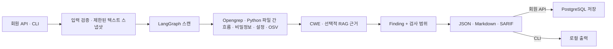

# SecRAGraph

[](https://github.com/taehyeon-git/SecRAGraph/actions/workflows/ci.yml) · [Code Scanning](https://github.com/taehyeon-git/SecRAGraph/security/code-scanning) · [아키텍처](docs/architecture.md) · [실행 데모](docs/demo.md)

**제출된 소스 코드를 실행하지 않고 보안 문제를 찾고, 무엇을 검사했는지와 근거를 함께 보고하는 백엔드·DevSecOps 포트폴리오입니다.**
회원은 파일이나 ZIP을 올려 소스·비밀정보·설정·의존성을 검사하고, 본인의 JSON·Markdown·SARIF 보고서를 다시 볼 수 있습니다. LangGraph는 검사와 근거 보강을 조정합니다. DAST, Git 이력, 컨테이너 이미지는 별도의 신뢰된 CLI·CI 경로에서 검사합니다.

## 문제 정의

보안 경고만 나열하면 검사 실패와 미지원 파일을 놓치기 쉽습니다. SecRAGraph는 결과를 공통 `Finding`으로 정리하고 **탐지 위치·검사 엔진·실행 상태·검사 범위·근거**를 함께 기록합니다. 제출한 소스는 실행하거나 import하지 않으며 비밀 원문과 소스 줄도 보고서에 넣지 않습니다.

## 시작 및 구동

Python 3.11 이상, `uv`, Linux Docker 엔진을 준비한 뒤 저장소 루트에서 실행합니다.

```text
uv run --frozen python -m scripts.local_up
```

이 명령이 초기 CWE 자료, RAG 평가, Compose 빌드, DB 마이그레이션, 서비스 준비와 최초 회원 생성을 진행합니다. 실행 후 [웹 화면](http://127.0.0.1:8501)에서 로그인하거나 [API 문서](http://127.0.0.1:8000/docs)를 볼 수 있습니다. 포트는 로컬 루프백에 바인딩됩니다.

CLI에서 파일을 직접 검사할 수도 있습니다. 호스트에서 실행할 때 Opengrep·Gitleaks·Checkov 바이너리를 별도로 준비해야 하며, 없는 엔진은 보고서에 `not_run`으로 남습니다.

```powershell
uv run security-review scan examples/insecure/sample.py --format markdown
```

코드 검사에는 모델 API 키가 필요하지 않습니다. 모델 기반 질의와 Qdrant 문서 검색은 제공자 키를 설정한 경우에 동작합니다. 재실행·종료·복구와 설정은 [운영 문서](docs/operations.md)에 있습니다.

## 핵심 아키텍처



| 경로 | 검사 대상과 도구 |
| --- | --- |
| **회원 업로드·CLI** | Opengrep SAST와 정적 Python 파일 간 흐름, Gitleaks 비밀정보, Checkov와 Docker Compose 정책, 잠금 파일의 정확한 패키지 버전에 대한 OSV.dev 조회 |
| **신뢰된 Git 체크아웃** | Gitleaks로 선택한 커밋의 비밀정보 검사. 회원 업로드에서 Git 이력 검사를 시작할 수 없음 |
| **격리된 테스트 API** | ZAP 패시브 검사와 명시적으로 허용한 능동 검사. 운영 URL을 받는 회원 API 기능은 없음 |
| **CI 빌드 이미지** | Trivy로 OS·언어 패키지와 이미지 설정 검사, CycloneDX SBOM 생성. 회원 업로드에서 이미지 빌드·검사를 시작할 수 없음 |
| **공개 저장소 자체** | GitHub Actions의 CodeQL `security-extended`. 회원이 업로드한 비공개 코드에는 적용하지 않음 |

Opengrep은 Python·JavaScript/TypeScript의 규칙 패턴과 **같은 파일 안의 함수 간** 일부 웹 입력 흐름을 검사합니다. 별도 `python-flow` 엔진은 Python의 정적 로컬 import와 단순 함수 호출을 따라 파일 간 명령 실행·SQL 쿼리 문자열 흐름을 검사합니다. 지원 규칙·파일 형식, 실제 실행 엔진과 검사 실패는 보고서에 남깁니다. 검사별 상세 범위와 신뢰 경계는 [아키텍처](docs/architecture.md) 및 [위협 모델](docs/threat-model.md)에 있습니다.

## LangGraph 워크플로

소스 스캔 그래프는 **입력 검증 → 정적 검사 → 결과 정규화 → OSV 조회 → 필요한 CWE 확인 → 근거 검색 → 위험도·보고서 생성** 순서로 진행합니다. 외부 조회가 실패해도 이미 확인한 finding은 유지하고 범위 경고를 남깁니다. Git 이력과 이미지 검사는 각자의 입력 검증·전용 엔진을 거쳐 같은 보고서 모델을 사용합니다.

## RAG와 Text2SQL

- **근거 보강:** finding이나 새 질문에 필요한 CWE를 공식 MITRE 자료로 확인합니다. 임베딩 제공자가 설정되면 Qdrant 문서도 검색합니다. RAG는 취약점 여부를 확정하는 탐지 엔진이 아니라 확인된 결과의 출처를 보강하는 기능입니다.
- **지식 질의:** 별도 LangGraph가 질문을 분류하고 재검색 또는 근거를 인용한 답변·보류를 선택합니다. Text2SQL은 SQLGlot으로 검사한 뒤 `intel.cwe`·`intel.cve`의 제한된 읽기 전용 질의만 실행합니다.

PDF는 자동 탐색·다운로드하지 않습니다. [공식 문서 수집 절차](docs/official-corpus.md), [Text2SQL 제어](docs/text2sql-security.md), [OSV 전송 정보](docs/osv.md)를 참고하세요.

## 검증 결과

스캐너와 DAST는 2026-10-31 로컬 Docker 재측정, 나머지 항목은 [2026-10-30 `main` CI 실행](https://github.com/taehyeon-git/SecRAGraph/actions/runs/41074726955)의 결과입니다. 평가별 대상과 분모가 달라 하나의 탐지율로 합산하지 않습니다.

| 평가 | 결과 |
| --- | --- |
| 회원 API 전체 왕복 (2026-10-30) | 로그인·혼합 ZIP·4개 엔진·저장 보고서·소유권 등 **10/10 계약 통과**, finding 10건, 경고 0건 |
| 스캐너 제작 사례 (2026-10-31) | **29/29 사례, 162/162 라벨**, TP 44 · FP 0 · FN 0, 파일 간 흐름 경로 포함 **6/6** 확인. 실행 189,926ms |
| RAG·OSV/CWE 연동 계약 | 오프라인 RAG 4/4, 주입형 제공자 계약 1/1. 같은 검색 질의를 사용하는 finding 20건의 호출을 **20회에서 1회**로 개선 |
| 격리 API DAST (2026-10-31) | **8/8 사례**, TP 4 · FP 0 · FN 0 · TN 4. 숫자형 SQLi 별도 차등 엔진 16회 요청, 827ms |
| CI 이미지·SBOM | 구성요소 386개, Trivy 권고 383건 기록. 기존 고위험 항목은 해결 과제 |
| Git 이력·의존성 감사 | 선택 커밋의 새 비밀정보 finding 0건, 의존성 감사 통과 |

회원 API의 업로드·검사 단계는 2026-10-30 CI 러너에서 **24,445ms**였습니다. 시간은 환경과 캐시에 따라 달라집니다. 제작 사례의 점수는 회귀 시험 결과이며 임의 저장소의 탐지율이나 실제 악용 가능성을 뜻하지 않습니다. 외부 OWASP BenchmarkPython 90개 사례의 별도 결과는 **TP 27 · FP 19 · FN 9 · TN 35**로 유지됩니다.

분모와 재현 방법: [스캐너 평가](docs/demo.md) · [전체 파이프라인 측정과 개선 내역](docs/evidence/pipeline-benchmark-2026-10-30.md) · [외부 스캐너 도전](docs/evidence/multiengine-external-2026-10-27.md) · [DAST 평가](docs/evidence/dast-benchmark.md)

## 테스트와 CI

문서·CLI만 빠르게 검증할 때:

```powershell
uv run pytest tests/unit/docs/test_documentation.py tests/e2e/test_cli.py
```

전체 통합 테스트에는 [테스트 전용 Compose](tests/compose.integration.yaml)의 PostgreSQL `127.0.0.1:55432`와 Qdrant `127.0.0.1:56333`이 필요합니다. 일부 테스트는 실행 중인 API를 `SECRAGRAPH_TEST_API_URL`로 지정합니다.

[CI](.github/workflows/ci.yml)는 정적 검사·단위/통합 테스트·스캐너 회귀·DAST·이미지/SBOM·Git 이력 검사를 실행하고, 신뢰된 `main` 실행의 8개 트랙 증거를 아티팩트로 게시합니다. 공개 코드의 [CodeQL 검사](.github/workflows/security-scan.yml)는 별도 워크플로입니다.

## 한계

- **탐지 범위:** Python 파일 간 분석은 정적 로컬 import와 지원 함수·sink에 한정됩니다. 동적 import, 복잡한 객체 흐름과 다른 언어의 파일 간 흐름은 남은 과제입니다. DAST의 숫자형 SQL 주입은 승인된 일회용 대상의 응답 비교로 검사하며, 응답이 불안정하거나 의미 있는 차이가 없는 취약점은 놓칠 수 있습니다. 작성자 회귀 사례의 FP·FN이 0이어도 임의 저장소의 정확도를 보장하지 않습니다.
- **외부 근거:** OSV는 지원 잠금 파일의 정확한 버전만 조회합니다. 모델 답변과 수집 문서의 품질은 별도 검증이 필요하며, 주입형 제공자 계약은 실시간 제공자의 정확도를 측정하지 않습니다.
- **운영 보안:** 회원 로그인은 로컬 데모용입니다. 속도 제한·MFA·계정 복구가 없어 인터넷에 그대로 배포할 수 없습니다. 외부 검사기는 API 컨테이너와 네트워크 네임스페이스를 공유합니다.
- **이미지 위험:** 위 고정 CI 실행의 Trivy 권고 383건에는 HIGH 107건·CRITICAL 6건이 포함됩니다. CI 기준선은 새 고위험 항목을 차단하지만 기존 항목을 해결하지는 않습니다. 권고가 곧 실제 악용 가능성을 증명하는 것은 아닙니다.

## 출처와 기여

팀 교육 프로젝트 `rag-documents`와 `security-agent-langgraph`의 접근을 독립적으로 통합했습니다. 팀 결과를 개인 단독 성과로 표시하지 않습니다. 직접 기여와 기존 프로젝트의 경계는 [출처와 크레딧](docs/origins-and-credits.md)에 기록했고, [MIT 라이선스](LICENSE)는 새로 작성한 SecRAGraph 코드에 적용됩니다.
