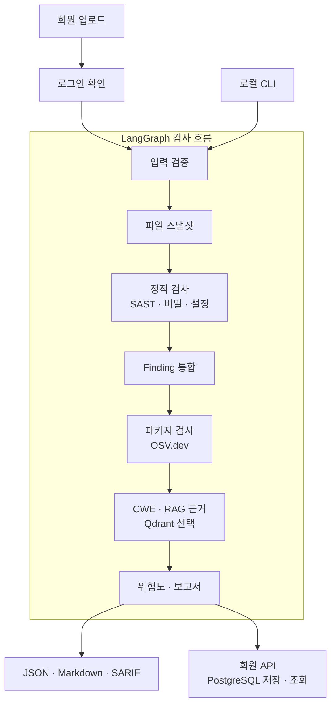

# SecRAGraph

[](https://github.com/taehyeon-git/SecRAGraph/actions/workflows/ci.yml) · [Code Scanning](https://github.com/taehyeon-git/SecRAGraph/security/code-scanning) · [상세 아키텍처](docs/architecture.md) · [평가·재현](docs/demo.md)

**코드부터 의존성·설정·배포 이미지까지 검사하고, 결과의 근거와 검사 범위를 함께 보여주는 DevSecOps 포트폴리오입니다.** 회원은 파일이나 ZIP을 업로드해 보고서를 저장·조회할 수 있고, CLI는 로컬 파일·디렉터리를 검사합니다. LangGraph는 검사와 근거 보강을 조정합니다.

## 문제 정의

보안 경고의 개수만으로는 무엇을 검사했는지, 어느 도구가 실패했는지 알기 어렵습니다. SecRAGraph는 탐지 결과를 공통 `Finding`으로 정리하고 **위치·검사 엔진·실행 상태·검사 범위·출처**를 보고합니다. 제출한 소스는 실행하거나 import하지 않으며, 비밀 원문과 소스 줄은 보고서에 넣지 않습니다.

## 시작 및 구동

Python 3.11 이상, `uv`, Linux Docker 엔진(Docker Desktop의 Linux 모드 포함)을 준비합니다. 저장소 루트에서 다음 한 명령으로 로컬 스택을 시작합니다.

```text
uv run --frozen python -m scripts.local_up
```

초기 CWE 자료와 RAG 평가를 준비하고, Compose 빌드·DB 마이그레이션·서비스 준비·최초 회원 생성을 진행합니다. 이후 [웹 화면](http://127.0.0.1:8501)에서 로그인하거나 [API 문서](http://127.0.0.1:8000/docs)를 확인할 수 있습니다. 공개 포트는 로컬 루프백에 바인딩됩니다.

코드 검사에는 모델 API 키가 필요하지 않습니다. 모델 기반 질의와 Qdrant 문서 검색에는 제공자 키와 인덱싱된 자료가 필요합니다. CLI에서 파일을 직접 검사하려면 다음 명령을 사용합니다.

```powershell
uv run --frozen security-review scan examples/insecure/sample.py --format markdown
```

호스트 CLI 검사에는 Opengrep·Gitleaks·Checkov 실행 파일이 별도로 필요하며, 실행하지 못한 엔진은 보고서에 `not_run`으로 표시됩니다. 스택의 재실행·종료·복구는 [운영 문서](docs/operations.md)를 참고하세요.

## 핵심 아키텍처

회원 업로드와 CLI는 같은 LangGraph 검사 흐름을 사용합니다. 그림에는 각 단계의 역할만 짧게 표시하고, 실제 검사 도구와 별도 CI 검사는 아래 표에 정리했습니다.



제출 코드는 실행하지 않고 파일을 읽어 검사합니다. Git 이력·테스트 API·이미지 검사는 별도의 신뢰된 CLI·CI 경로에서 실행합니다. 회원 요청으로 임의의 URL이나 이미지 빌드를 실행할 수는 없습니다.

| 경로 | 검사 대상과 도구 |
| --- | --- |
| 회원 업로드·CLI | Opengrep SAST, 정적 Python 파일 간 흐름, Gitleaks 비밀정보, Checkov·Compose 설정, 잠금 파일의 OSV.dev 조회 |
| 신뢰된 CLI·CI | 선택한 Git 커밋의 Gitleaks 이력 검사, 허용된 일회용 테스트 API의 ZAP DAST, 빌드된 이미지의 Trivy 검사·CycloneDX SBOM |
| 공개 저장소 CI | CodeQL `security-extended`로 저장소 자체를 검사. 회원이 업로드한 비공개 코드에는 적용하지 않음 |

검사 대상·지원 언어·실패 상태와 신뢰 경계는 [상세 아키텍처](docs/architecture.md)와 [위협 모델](docs/threat-model.md)에 기록했습니다.

## LangGraph 워크플로

스캔 그래프의 실제 노드는 다음 순서로 연결됩니다.

```text
validate_input → deterministic_scan → normalize_findings
→ audit_dependencies → prepare_cwe_evidence → retrieve_finding_evidence
→ calculate_risk → build_report
```

각 엔진의 실행 상태·버전·적격 파일·확인 가능한 검사 경로·시간을 `ScanExecution`에 남깁니다. Gitleaks는 finding이 발생한 경로만 확인된 검사 경로로 기록합니다. OSV·CWE·검색 요청이 실패해도 확인된 `Finding`은 유지하고 보고서에 범위 경고를 표시합니다.

## RAG와 Text2SQL

- **결과의 근거:** 실제 `Finding`의 CWE ID에 맞는 MITRE 공식 자료를 확인합니다. 설정된 경우 Qdrant 문서의 출처도 붙입니다. RAG가 코드의 취약 여부를 결정하거나 CWE에서 CVE를 추정하지는 않습니다.
- **보안 지식 질의:** 별도 지식 LangGraph가 일반 답변·Text2SQL·문서 검색 중 경로를 선택합니다. 문서 검색 경로에서는 근거를 재검색하고 인용 가능한 답변 또는 답변 보류를 선택합니다. Text2SQL은 SQLGlot 검사를 거쳐 PostgreSQL `intel.cwe`·`intel.cve`에 제한된 읽기 전용 질의만 수행합니다.

PDF는 자동 탐색·다운로드하지 않습니다. 자료 수집은 [공식 문서 절차](docs/official-corpus.md), 질의 제한은 [Text2SQL 보안](docs/text2sql-security.md), 패키지 조회 범위는 [OSV 설명](docs/osv.md)을 참고하세요.

## 검증 결과

아래 값은 서로 다른 대상·날짜의 기록이며 하나의 탐지율로 합산하지 않습니다. 자세한 입력과 재현 절차는 [평가 문서](docs/demo.md)에 있습니다.

| 검증 대상 | 기록 | 해석 |
| --- | --- | --- |
| 회원 API 전체 왕복 (2026-10-30) | 로그인·ZIP 업로드·4개 엔진·보고서 조회·소유권 계약 **10/10 통과** | 업로드·검사 단계 24,445ms; 해당 CI 환경의 측정 |
| 작성자 스캐너 사례 (2026-10-31) | **29/29 사례**, TP 44 · FP 0 · FN 0, 흐름 경로 6/6 | 작은 회귀 자료의 결과 |
| 외부 OWASP BenchmarkPython (2026-10-27) | 지원 범위 90개 사례: TP 27 · FP 19 · FN 9 · TN 35 | CWE-78·89·502의 제한된 사례 단위 도전 |
| 격리 테스트 API DAST (2026-10-31) | **8/8 사례**, TP 4 · FP 0 · FN 0 · TN 4 | 작성자 합성 API의 패시브·능동 검사 |
| RAG·그래프 계약 | 동봉 자료 질문 4/4, 주입형 제공자 계약 1/1 | 실제 모델 답변 품질은 측정하지 않음 |
| 런타임 이미지 (2026-11-16 로컬) | SBOM 구성요소 347개, Trivy 권고 206건 중 고위험·미상 49건 | 동일 DB의 수정 전 95건과 [재검사 비교](docs/evidence/container-image-remediation-2026-11-16.md) |

작성자 사례의 높은 점수는 임의 저장소의 탐지율을 뜻하지 않습니다. 외부 사례의 분모와 규칙별 결과는 [스캐너 평가](docs/demo.md), DAST의 요청·시간은 [DAST 평가](docs/evidence/dast-benchmark.md), 전체 경로의 시간은 [파이프라인 측정](docs/evidence/pipeline-benchmark-2026-10-30.md)에 있습니다.

## 테스트와 CI

문서와 CLI를 확인하는 집중 테스트:

```powershell
uv run pytest tests/unit/docs/test_documentation.py tests/e2e/test_cli.py
```

전체 통합 테스트에는 [테스트 전용 Compose](tests/compose.integration.yaml)의 PostgreSQL `127.0.0.1:55432`와 Qdrant `127.0.0.1:56333`이 필요합니다. 실행 중인 API를 사용하는 일부 테스트는 `SECRAGRAPH_TEST_API_URL`을 설정합니다.

[CI](.github/workflows/ci.yml)는 품질·단위/통합 테스트·스캐너 회귀·의존성·DAST·이미지/SBOM·Git 이력 검사를 실행합니다. [CodeQL](.github/workflows/security-scan.yml)은 별도 워크플로입니다. 둘 다 PR·`main` push·수동 실행에서 동작하며 주간 예약 실행은 없습니다. 신뢰된 `main` 실행에서 검사별 증거 아티팩트를 게시하고, 선행 작업이 모두 통과하면 합산한 파이프라인 벤치마크를 게시합니다.

## 한계

- **탐지 범위:** Python 파일 간 분석은 정적 로컬 import와 지원 함수·sink에 한정됩니다. 다른 언어의 파일 간 흐름과 복잡한 동적 호출은 놓칠 수 있습니다. DAST의 응답 비교도 불안정한 응답이나 차이가 드러나지 않는 취약점을 놓칠 수 있습니다.
- **근거와 평가:** OSV는 지원 잠금 파일의 정확한 버전을 조회합니다. 모델 답변의 품질은 별도 검증이 필요하며, 작성자 회귀 사례의 FP·FN이 0이어도 일반적인 탐지 성능을 보장하지 않습니다.
- **배포:** 회원 로그인은 로컬 데모용입니다. 속도 제한·MFA·계정 복구가 없어 인터넷 공개용으로 준비되지 않았습니다. 외부 검사기는 API 컨테이너와 네트워크 네임스페이스를 공유합니다.
- **이미지 권고:** 재검사 결과 HIGH 44건·UNKNOWN 5건이 남았습니다. Debian 패키지의 서로 다른 권고 14개와 Checkov `ecdsa` 1건을 계속 추적합니다. CI 기준선은 새 고위험 항목을 차단하지만 기존 항목을 해결하지 않습니다. 권고만으로 실제 악용 가능성이 증명되지는 않습니다.

## 출처와 기여

팀 교육 프로젝트 `rag-documents`와 `security-agent-langgraph`의 접근을 독립적으로 통합했습니다. 팀 결과를 개인 단독 성과로 표시하지 않습니다. 직접 기여와 기존 프로젝트의 경계는 [출처와 크레딧](docs/origins-and-credits.md)에 기록했고, [MIT 라이선스](LICENSE)는 새로 작성한 SecRAGraph 코드에 적용됩니다.
