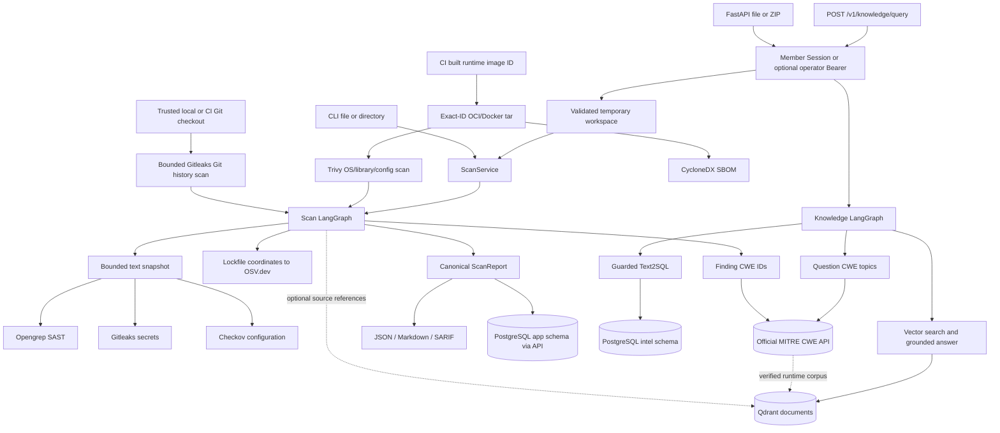

# 아키텍처

SecRAGraph는 Python 모듈형 단일 서비스입니다. 정적 스캔과 지식 질의가 같은 API 프로세스에 있지만, 서로 다른 LangGraph와 의존성 경계를 가집니다. [README](../README.md)의 단일 시작 명령은 이 구조의 로컬 Compose 배치를 사용합니다.

## 요청과 데이터 흐름



CLI는 `scan_path`로 로컬 파일·디렉터리를 스캔하고 그 자리에서 보고서를 렌더링합니다. 기본 CLI 그래프에는 retriever가 없고 PostgreSQL에 보고서를 저장하지 않지만, 지원되는 잠금 파일이 있으면 OSV 자동 감사를 연결합니다. API의 `ScanService`는 영속 보고서 저장소와 기본 OSV 감사를 받고, 설정된 키와 인프라가 있으면 Qdrant retriever도 연결합니다. API는 한 파일 또는 검증한 ZIP을 동기적으로 처리하고 PostgreSQL에 보고서를 저장합니다. `/v1/*` 보호 경계는 본문 읽기 전에 회원 Session 또는 설정된 경우 선택적 운영 Bearer 토큰을 확인합니다. Streamlit은 회원 로그인을 제공하고 Session 자격 증명을 서버 측 세션 상태에 보관합니다. 보고서의 소유자 필터는 JSON, Markdown, SARIF 조회에 적용됩니다. [회원 인증과 운영자 권한](membership.md)을 참고하세요.

이미지 경로는 이 저장소의 CI 또는 신뢰된 로컬 운영자가 만든 tar만 받습니다. `scan-image`는 tar를 빌드·실행·다운로드하지 않으며 회원 API에 이미지 업로드 경로가 없습니다. Trivy 0.76.1이 최종 이미지의 OS·언어 패키지와 이미지 설정을 읽고 CycloneDX SBOM을 생성합니다. tar SHA-256, 로컬 Docker ID, OCI manifest/config 연결, Trivy JSON과 SBOM의 config digest를 확인한 뒤 정규화된 finding을 스캔 LangGraph에 전달합니다. 이미지 finding은 패키지의 논리적 위치를 갖고 소스 줄을 주장하지 않습니다. [이미지 검사 설계](design/container-image-sbom.md)를 참고하세요.

`scan-history`는 별도의 신뢰된 로컬/CI Git 체크아웃을 대상으로 합니다. 커밋 집합을 사전 확인한 뒤 Gitleaks가 반환한 비밀 없는 메타데이터를 같은 스캔 LangGraph에 넘깁니다. 회원 업로드, ZIP, FastAPI 요청으로는 이력 스캔을 시작할 수 없습니다. 역사적 finding은 과거 커밋 SHA를 보존하며 SARIF에는 현재 파일의 물리적 위치 대신 논리적 위치를 기록합니다.

CLI와 API 스캔 모두 기본적으로 finding에 나타난 CWE ID로 공식 문서를 확인합니다. CLI에는 Qdrant retriever가 없으므로 공식 출처를 보고서에 연결하고, 임베딩 제공자가 구성된 API는 같은 문서를 검색 코퍼스에도 추가합니다. RAG 질문의 자동 수집은 ChatModel이 연결된 지식 API에서만 동작합니다.

## 두 LangGraph의 실제 노드

스캔 그래프([scan_graph.py](../src/security_review/orchestrator/scan_graph.py)):

```text
validate_input → deterministic_scan → normalize_findings
→ audit_dependencies → prepare_cwe_evidence → retrieve_finding_evidence
→ calculate_risk → build_report
```

`retrieve_finding_evidence`는 규칙 결과의 `references`에 Qdrant 문서 출처를 합칩니다. finding ID, 탐지 위치, 심각도, CWE 매핑, 수정 권고는 결정적 결과를 유지합니다. 이 노드는 ChatModel 또는 PostgreSQL Text2SQL을 호출하지 않습니다. 검색 불가·시간 한도 초과 시 확인된 finding을 보존하고 `completed_with_warnings` 보고서를 만들 수 있습니다. 스캔 경로의 기본 수정 권고는 LLM 생성 문장이 아닙니다.

`deterministic_scan`은 제한된 UTF-8 스냅샷을 만들고 Opengrep·Gitleaks·Checkov를 별도 프로세스로 실행하며 Docker Compose 파일은 별도 `compose-policy` 어댑터가 파싱합니다. Checkov에는 Compose 파일을 제외한 적격 파일만 복사한 비공개 작업 디렉터리를 넘깁니다. 전용 어댑터는 Docker Compose 명령이나 파일 참조를 실행·로드하지 않고 선언된 설정만 확인합니다. 각 엔진의 상태·버전·대상과 확인된 파일·시간·경고를 `ScanExecution`에 정규화합니다. 대상 파일을 import하거나 실행하지 않습니다. `audit_dependencies`는 공개 레지스트리 `uv.lock`/`package-lock.json`의 정확한 버전만 OSV에 조회하고, 실제 권고가 있으면 의존성 finding을 추가합니다. 잠금 파일 원문이나 대상 코드는 전송하지 않습니다. OSV 실패와 미지원 항목은 범위 경고로 남기고 이미 확인한 finding을 보존합니다. CLI `--offline`과 API `SECRAGRAPH_AUTO_OSV_ENABLED=false`는 이 외부 단계를 끕니다.

`prepare_cwe_evidence`는 실제 스캔 결과의 CWE ID를 중복 제거하고 항목별 검증 캐시를 확인합니다. 없는 항목만 고정된 MITRE HTTPS API로 조회합니다. 응답의 CWE ID·형식·크기와 로컬 manifest SHA-256을 검사한 뒤 공식 출처를 finding에 연결합니다. 인덱서가 있으면 같은 Qdrant 컬렉션의 별도 런타임 코퍼스 ID로 문서를 추가합니다. 초기 사례 코퍼스 재동기화가 이 코퍼스를 제거하지 않습니다. 취득 실패·시간 초과·상한 도달 시 결정적 finding을 보존하고 범위 경고를 남깁니다. MITRE에는 업로드 코드나 질문 전문이 아닌 CWE ID만 보냅니다. CLI `--offline`과 API `SECRAGRAPH_AUTO_CWE_ENABLED=false`로 자동 조회를 끌 수 있습니다.

지식 그래프([knowledge_graph.py](../src/security_review/orchestrator/knowledge_graph.py)):

```text
classify_intent ─┬→ general_answer → END
                 ├→ text2sql → END
                 └→ prepare_cwe_evidence → vector_search → evaluate_vector_results
                       ├→ generate_grounded_answer → END
                       ├→ rewrite_query → vector_search (bounded retry)
                       └→ END (insufficient evidence)
```

분류·일반 답변·검색어 재작성·근거 기반 답변은 설정된 ChatModel을 사용합니다. RAG 답변은 실제 검색 chunk ID를 `[source:<id>]` 형식으로 인용해야 하며 없는 출처 ID를 반환하면 오류가 됩니다. 일반 답변은 문서나 DB 조회를 수행하지 않으므로 인용 근거가 없는 개념 설명입니다. Text2SQL은 별도 [보안 경계](text2sql-security.md)를 거칩니다.

키 없는 [오프라인 RAG 증거 명령](demo.md#2-키-없는-오프라인-rag-근거)은 같은 지식 LangGraph와 `QdrantDocumentRetriever`를 사용하되, 동봉한 Markdown 지침을 메모리 내 Qdrant에 인덱싱하고 결정적 토큰 해시 임베딩·응답 어댑터로 네 가지 고정 경로를 실행합니다. 완료된 노드, 검색 후보 메타데이터, 실제 인용 ID 및 인용된 조각의 짧은 발췌만 JSON/Markdown으로 렌더링합니다. 검색됐지만 인용되지 않은 조각의 원문과 LangGraph 원시 상태 전체는 저장하지 않습니다. 이 경로의 결과는 워크플로·검색·인용 계약의 재현 가능한 검사이며 실제 모델 답변 품질 측정은 아닙니다.

런타임 CWE 제공자가 연결되면 분류 모델은 경로와 관련 CWE 후보를 한 번에 제안합니다. 질문에 직접 적힌 CWE ID가 있으면 이를 우선하며, 후보가 없으면 새 공식 문서를 요청하지 않습니다. 제안은 식별자 후보일 뿐 취약점이나 CVE의 확인이 아니며 공식 MITRE 응답으로 검증한 항목만 근거가 됩니다. `text2sql`과 `general_answer` 경로는 이 수집 단계를 거치지 않습니다. 이 기능에는 모델·임베딩 키와 사용 가능한 Qdrant가 필요합니다. 키 없는 고정 RAG 평가는 별도 재현 경로입니다.

## 모듈과 인터페이스

| 위치 | 책임 / 외부 경계 |
| --- | --- |
| `src/security_review/domain/models.py`, `risk.py` | 검증된 `Finding`, `SourceReference`, `ScanReport`와 결정적 위험 점수. FastAPI·DB·모델 SDK에 의존하지 않습니다. |
| `scanner/files.py`, `snapshot.py`, `opengrep_adapter.py`, `external_detectors.py`, `compose_adapter.py` | 지원 파일 탐색·한도, 별도 비실행 스냅샷, 신뢰된 검사기 호출과 Docker Compose 선언 검사·결과 정규화. 소스 줄이나 비밀 원문을 보고서에 복사하지 않습니다. |
| `history/engine.py`, `history_review.py` | 신뢰된 Git 체크아웃의 유한 커밋 집합을 검증하고 Gitleaks Git 모드의 비밀 없는 결과를 같은 LangGraph 보고서로 보냅니다. |
| `uploads/service.py`, `archive.py` | 파일명·MIME·크기 검증, ZIP 경로·링크·개수·압축 해제량 검사 후 임시 디렉터리 사용. |
| `application.py` | CLI의 `scan_path`와 API의 `ScanService`; 같은 스캔 그래프를 조립하고 API 경로에서는 보고서를 저장합니다. |
| `orchestrator/scan_graph.py`, `knowledge_graph.py`, `state.py` | 각 LangGraph의 상태, 노드, 조건부 분기와 결과 계약. |
| `ports.py` | `ReportRepository`, `SecurityKnowledgeRepository`, `SecurityDocumentRetriever`, `ChatModel`, `EmbeddingModel` 프로토콜. 구현을 도메인 밖에 둡니다. |
| `intelligence/ingestion.py`, `manifest.py`, `models.py` | 사용자 소유 UTF-8 Markdown 문서 탐색·chunk, 버전별 출처/권리/해시 검증, 코퍼스 식별자 및 지식 데이터 모델. |
| `intelligence/case_corpus.py`, `dynamic_cwe.py` | 평가 사례와 질문의 초기 CWE 코퍼스 준비, 실제 스캔·질문에서 발생한 CWE ID별 공식 자료 검증·캐시·선택적 인덱싱. |
| `intelligence/qdrant_retriever.py`, `openai_adapters.py` | 컬렉션/차원 확인, bounded 검색·임베딩·모델 제공자 어댑터, 선택 관리 코퍼스의 미리보기/동기화. |
| `intelligence/text2sql.py`, `sql_guard.py` | 모델 SQL 생성·재시도·답변 합성 및 SQLGlot AST 검증. |
| `storage/database.py`, `reports.py`, `memory.py`, `models.py` | SQLAlchemy 연결·스캔 보고서 영속화·테스트용 메모리 저장소·테이블. |
| `storage/intelligence.py`, `audit.py` | 합성 CSV 형식 검증과 `intel` 적재, 읽기 전용 쿼리 실행, 내용 없는 감사 이벤트 저장. |
| `reporting/builder.py`, `types.py`, `json_report.py`, `markdown.py`, `sarif.py` | 하나의 `ScanReport` 정규화와 JSON/Markdown/SARIF 2.1.0 렌더링. |
| `container_image/`, `container_review.py` | 신뢰된 로컬 tar의 Trivy 결과와 SBOM을 검증·정규화하고 동일 LangGraph 보고 경로에 연결. |
| `evaluation/offline_rag.py`, `rag_models.py`, `rag_render.py` | 고정 매니페스트·인덱싱된 chunk digest·실제 RAG 그래프 경로를 평가하고 제한된 증거를 렌더링. |
| `scripts/run_rag_evidence.py` | 키 없는 RAG 평가를 실행하고 JSON/Markdown 파일을 원자적으로 기록하며 라벨 불일치를 실패로 반환. |
| `evaluation/live_rag.py`, `scripts/run_live_rag_evidence.py` | 명시적 모델 키가 있을 때만 동일 지식 그래프의 제공자 경로를 관찰하고 지표 분모·모델 ID·해시·사람 검토 필요성을 로컬에 기록. |
| `evaluation/multiengine_benchmark.py`, `scripts/run_multiengine_benchmark.py` | 현재 검사기를 공개 스캔 경로로 평가하고 엔진·규칙·파일·줄의 라벨, 범위와 시간을 JSON/Markdown으로 기록. |
| `api/app.py`, `member_auth.py`, `dependencies.py`, `schemas.py`, `middleware.py`, `errors.py`, `routes/members.py` | FastAPI 조립, 회원 Session 및 선택적 운영 Bearer 인증 경계, 의존성 주입, 검증 요청, 상관 ID와 안전한 오류 응답. |
| `api/routes/scans.py`, `reports.py`, `knowledge.py`, `health.py` | 파일·ZIP 업로드, 영속 보고서 조회/렌더링, 지식 질의, 생존/준비 상태 HTTP 경로. |
| `cli.py`, `apps/api/`, `apps/web/` | Typer CLI, Uvicorn 진입점, Streamlit 데모. |
| `audit.py`, `observability.py`, `config.py` | 허용 목록 기반 감사 이벤트, 구조화 로그, 환경 기반 설정. |

`migrations/`는 `app`과 `intel` 스키마 및 읽기 권한을 만들고 과거 보고서의 소스 증거를 고정 문구로 대체합니다. `infra/postgres/init/`은 reader 로그인을 부트스트랩합니다. [Compose](../compose.yaml)는 PostgreSQL·Qdrant·API·웹과 일회성 초기화 서비스를 연결합니다. [CI](../.github/workflows/ci.yml)는 키 없는 평가 증거와 별도 Compose 스모크를 실행하도록 정의되어 있으며, 신뢰된 `main`에서만 아티팩트를 게시합니다. [보안 셀프 스캔](../.github/workflows/security-scan.yml)과 함께 호스팅 실행 성공은 해당 커밋의 실행에서 확인해야 합니다.

HTTP 계약은 `GET /health/live`, `GET /health/ready`, `POST /v1/auth/login`, `POST /v1/auth/logout`, `POST /v1/scans/file`, `POST /v1/scans/archive`, `GET /v1/scans/{scan_id}`, `GET /v1/scans/{scan_id}/report?format=markdown|sarif`, `POST /v1/knowledge/query`, `POST /v1/vulnerabilities/query`입니다. `/v1/auth/register`는 개발 환경에서 명시적으로 허용한 경우에만 사용할 수 있습니다. JSON 보고서는 저장된 canonical report이고 Markdown/SARIF은 같은 보고서에서 렌더링합니다.

## 검사 엔진과 측정 경계

회원 업로드의 SAST는 Opengrep 1.32.0과 [MIT 라이선스·커밋·파일 해시를 고정한 79개 규칙](../data/engines/opengrep/README.md), [프로젝트 작성 taint 규칙 3개](../data/engines/secragraph-taint/README.md)를 사용합니다. 웹 프레임워크 입력에서 명령 실행이나 SQL 쿼리 문자열까지의 흐름을 `--taint-intrafile`로 같은 파일의 함수 사이까지 추적하고, source·step·sink 경로/줄을 소스 내용 없이 기록합니다. 임의의 여러 파일을 지나는 데이터 흐름은 증명하지 않습니다. 비밀정보는 Gitleaks 8.30.1, Terraform·Dockerfile·Kubernetes 등 지원 설정은 Checkov 3.3.30, Docker Compose 선언은 `compose-policy`, 정확한 잠금 파일 패키지 권고는 OSV.dev가 담당합니다. 과거 자체 제작 8개 규칙은 현재 경로에서 제거했습니다.

공개 SecRAGraph 소스 자체는 [CodeQL `security-extended`](../.github/workflows/security-scan.yml)를 GitHub Actions에서 실행합니다. CodeQL의 무료 허용 범위에 맞춰 공개 소스에만 적용하며 비공개 회원 업로드에는 사용하지 않습니다. [별도 FastAPI 흐름 픽스처 쿼리](../codeql/FastApiCrossFileFlow.ql)는 `tests/fixtures/codeql_flow`에서 여러 파일 흐름과 차단 함수를 검증하는 테스트 자료입니다. 공개 코드에 대한 실제 경고는 `security-extended`에서 생성합니다. 이 규칙군은 기본 쿼리보다 낮은 정밀도의 쿼리도 포함하므로 결과를 사람이 검토해야 합니다.

`ScanExecution`은 엔진별 성공·부분·건너뜀·미실행·오류, 도구 버전, 입력 후보, 확인된 검사 파일과 소요 시간을 보존합니다. Gitleaks JSON은 파일별 전체 검사 목록을 주지 않으므로 확인 파일은 finding이 발생한 경로만 표시합니다. 입력 파일 제한·지원 언어·시간 초과로 제외된 부분을 성공으로 취급하지 않습니다. [평가 문서](demo.md)는 작성자 회귀 자료, 독립 라벨 코퍼스, 라벨 없는 실제 저장소를 분리해 설명합니다. 과거 자체 규칙의 수치는 [역사적 기록](evidence/expanded-scanner-2026-10-27.md)에만 보존합니다.

Git 이력 검사의 `ScanExecution`은 선택한 base/head SHA와 커밋 수를 별도로 기록합니다. 이 수치는 이력 선택 범위이며 파일별 검사 완료를 뜻하지 않습니다. CI는 PR의 실제 head 또는 push의 before/after 범위를 검사하고 발견 건을 별도 단계에서 실패로 처리합니다. 공개 Actions 아티팩트는 완료·검증된 발견 건 없는 `main` 결과에만 게시합니다.

이미지 검사의 `ScanExecution`은 tar·config digest, Trivy/DB 버전·시각, 취약점과 설정 결과 수, SBOM 구성요소 수와 해시를 기록합니다. CI는 완료·신원·DB 신선도를 확인하고 [검토된 기존 이미지 기준선](evidence/container-image-2026-10-30.md)을 넘는 HIGH·CRITICAL·UNKNOWN 취약점 및 위험한 이미지 설정을 차단합니다. 현재 이미지에서 여전히 발견되는 기준선 결과만 보고서에 포함하며 원본 Trivy JSON의 이미지 환경변수와 전체 tar는 공개 아티팩트로 올리지 않습니다. 소스 잠금 파일 OSV 조회, Dockerfile IaC 검사와 최종 이미지 패키지 검사는 서로 다른 대상입니다.

## 회원 인증과 취약점 조회

`POST /v1/auth/login`은 회원 자격 증명을 확인하고 opaque Session 토큰을 발급합니다. 저장소에는 토큰 digest만 저장하며 절대/유휴 만료, logout 폐기, 실패 로그인 잠금이 적용됩니다. 운영 Bearer 토큰은 설정 시 자동화 클라이언트의 대체 자격 증명으로 허용되며 웹 컨테이너에는 전달되지 않습니다. 사용자 계정과 기존 owner 없는 보고서의 동작은 [회원 문서](membership.md)에 있습니다.

일반 스캔의 OSV 단계는 잠금 파일에서 추출한 ecosystem/package/exact version만 OSV.dev에 보냅니다. 별도 `POST /v1/vulnerabilities/query`는 수동 좌표 조회도 제공합니다. 고정 HTTPS origin과 응답 크기·레코드 제한을 사용하며 불완전한 자동 조회는 범위 경고, 수동 조회 오류는 503으로 나타냅니다. OSV advisory ID와 실제 CVE 기본 ID 또는 alias만 사용하고 CWE나 정적 finding으로부터 CVE를 추정하지 않습니다. 구현과 한계는 [OSV 문서](osv.md)를 참고하세요.

관리 `sync-corpus`는 manifest의 명시 파일 중 Markdown과 PDF를 처리합니다. PDF는 SHA-256 검증 후 pypdf로 추출합니다. 입력 바이트·페이지 수·원시 페이지 스트림·추출 후 문자 수에 한도를 두지만, 압축된 PDF 데이터의 파싱 자원 소모를 완전히 제한하지는 않습니다. 자동 탐색·다운로드나 OCR은 없습니다. 파일은 컨테이너 밖의 로컬 CLI 프로세스에서 처리되므로 manifest provenance는 무해성이나 권리 허가를 의미하지 않습니다. [공식 PDF 코퍼스 절차](official-corpus.md)를 참고하세요.

## 실패와 신뢰 경계

로컬 검사기는 모델 키 없이 동작하지만 설치되어 있어야 합니다. 기본 로컬 API는 회원 Session으로 인증하며 `SECRAGRAPH_API_TOKEN`은 선택적 운영 Bearer 자격 증명입니다. 회원 로그인에는 IP별/전역 속도 제한이 없으므로 API와 웹은 루프백에 바인딩된 로컬 배포로만 사용해야 합니다. API 스캔 영속화는 PostgreSQL이 필요합니다. `/health/ready`는 PostgreSQL과 Qdrant 상태를 확인합니다. 임베딩·모델 기능에는 별도의 런타임 `SECRAGRAPH_OPENAI_API_KEY`, 맞는 Qdrant 컬렉션, 수집된 문서 또는 `intel` 데이터가 필요합니다. 구성되지 않은 지식 API는 503을 반환합니다. Text2SQL SQL이 안전 기준을 통과하지 못하면 DB를 조회하지 않습니다. 검증된 `sync-corpus`도 Qdrant에는 비원자적으로 적용되며 실패 후 동일 manifest로 재시도해야 합니다. 외부 검사기 프로세스는 현재 API 컨테이너와 네트워크 네임스페이스를 공유하므로 다운로드 금지 플래그를 완전한 네트워크 격리로 설명하지 않습니다.

업로드·검색 문서·DB 행·모델 결과는 모두 신뢰하지 않는 데이터입니다. 입력 크기, SQL 권한, 결과 길이, 출처 식별자를 각 경계에서 제한합니다. 남은 위험과 운영 전제는 [위협 모델](threat-model.md)과 [운영 문서](operations.md)에 있습니다.
