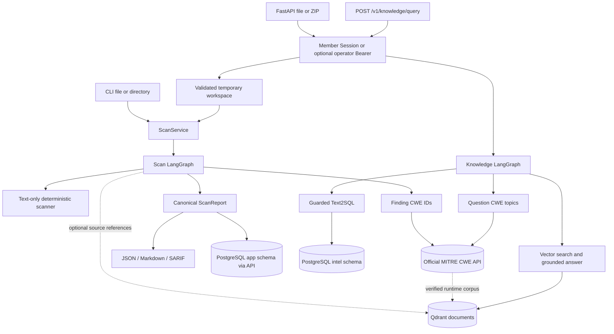

# 아키텍처

SecRAGraph는 Python 모듈형 단일 서비스입니다. 정적 스캔과 지식 질의가 같은 API 프로세스에 있지만, 서로 다른 LangGraph와 의존성 경계를 가집니다. [README](../README.md)의 단일 시작 명령은 이 구조의 로컬 Compose 배치를 사용합니다.

## 요청과 데이터 흐름



CLI는 `scan_path`로 로컬 파일·디렉터리를 스캔하고 그 자리에서 보고서를 렌더링합니다. 기본 CLI 그래프에는 retriever가 없고 PostgreSQL에 보고서를 저장하지 않지만, 지원되는 잠금 파일이 있으면 OSV 자동 감사를 연결합니다. API의 `ScanService`는 영속 보고서 저장소와 기본 OSV 감사를 받고, 설정된 키와 인프라가 있으면 Qdrant retriever도 연결합니다. API는 한 파일 또는 검증한 ZIP을 동기적으로 처리하고 PostgreSQL에 보고서를 저장합니다. `/v1/*` 보호 경계는 본문 읽기 전에 회원 Session 또는 설정된 경우 선택적 운영 Bearer 토큰을 확인합니다. Streamlit은 회원 로그인을 제공하고 Session 자격 증명을 서버 측 세션 상태에 보관합니다. 보고서의 소유자 필터는 JSON, Markdown, SARIF 조회에 적용됩니다. [회원 인증과 운영자 권한](membership.md)을 참고하세요.

CLI와 API 스캔 모두 기본적으로 finding에 나타난 CWE ID로 공식 문서를 확인합니다. CLI에는 Qdrant retriever가 없으므로 공식 출처를 보고서에 연결하고, 임베딩 제공자가 구성된 API는 같은 문서를 검색 코퍼스에도 추가합니다. RAG 질문의 자동 수집은 ChatModel이 연결된 지식 API에서만 동작합니다.

## 두 LangGraph의 실제 노드

스캔 그래프([scan_graph.py](../src/security_review/orchestrator/scan_graph.py)):

```text
validate_input → deterministic_scan → normalize_findings
→ audit_dependencies → prepare_cwe_evidence → retrieve_finding_evidence
→ calculate_risk → build_report
```

`retrieve_finding_evidence`는 규칙 결과의 `references`에 Qdrant 문서 출처를 합칩니다. finding ID, 탐지 위치, 심각도, CWE 매핑, 수정 권고는 결정적 결과를 유지합니다. 이 노드는 ChatModel 또는 PostgreSQL Text2SQL을 호출하지 않습니다. 검색 불가·시간 한도 초과 시 확인된 finding을 보존하고 `completed_with_warnings` 보고서를 만들 수 있습니다. 스캔 경로의 기본 수정 권고는 LLM 생성 문장이 아닙니다.

`audit_dependencies`는 공개 레지스트리 `uv.lock`/`package-lock.json`의 정확한 버전만 OSV에 조회하고, 실제 권고가 있으면 정보 등급 finding을 추가합니다. 잠금 파일 원문이나 대상 코드는 전송하지 않습니다. OSV 실패와 미지원 항목은 범위 경고로 남기고 정적 finding을 보존합니다. CLI `--offline`과 API `SECRAGRAPH_AUTO_OSV_ENABLED=false`는 이 외부 단계를 끕니다.

`prepare_cwe_evidence`는 실제 스캔 결과의 CWE ID를 중복 제거하고 항목별 검증 캐시를 확인합니다. 없는 항목만 고정된 MITRE HTTPS API로 조회합니다. 응답의 CWE ID·형식·크기와 로컬 manifest SHA-256을 검사한 뒤 공식 출처를 finding에 연결합니다. 인덱서가 있으면 같은 Qdrant 컬렉션의 별도 런타임 코퍼스 ID로 문서를 추가합니다. 초기 사례 코퍼스 재동기화가 이 코퍼스를 제거하지 않습니다. 취득 실패·시간 초과·상한 도달 시 결정적 finding을 보존하고 범위 경고를 남깁니다. MITRE에는 업로드 코드나 질문 전문이 아닌 CWE ID만 보냅니다. CLI `--offline`과 API `SECRAGRAPH_AUTO_CWE_ENABLED=false`로 자동 조회를 끌 수 있습니다.

지식 그래프([knowledge_graph.py](../src/security_review/orchestrator/knowledge_graph.py)):

```text
classify_intent ─┬→ general_answer → END
                 ├→ text2sql → END
                 └→ prepare_cwe_evidence → vector_search → evaluate_vector_results
                       ├→ generate_grounded_answer → END
                       ├→ rewrite_query → vector_search (bounded retry)
                       └→ END (insufficient evidence)
```

분류·일반 답변·검색어 재작성·근거 기반 답변은 설정된 ChatModel을 사용합니다. RAG 답변은 실제 검색 chunk ID를 `[source:<id>]` 형식으로 인용해야 하며 없는 출처 ID를 반환하면 오류가 됩니다. 일반 답변은 문서나 DB 조회를 수행하지 않으므로 인용 근거가 없는 개념 설명입니다. Text2SQL은 별도 [보안 경계](text2sql-security.md)를 거칩니다.

키 없는 [오프라인 RAG 증거 명령](demo.md#2-키-없는-오프라인-rag-근거)은 같은 지식 LangGraph와 `QdrantDocumentRetriever`를 사용하되, 동봉한 Markdown 지침을 메모리 내 Qdrant에 인덱싱하고 결정적 토큰 해시 임베딩·응답 어댑터로 네 가지 고정 경로를 실행합니다. 완료된 노드, 검색 후보 메타데이터, 실제 인용 ID 및 인용된 조각의 짧은 발췌만 JSON/Markdown으로 렌더링합니다. 검색됐지만 인용되지 않은 조각의 원문과 LangGraph 원시 상태 전체는 저장하지 않습니다. 이 경로의 결과는 워크플로·검색·인용 계약의 재현 가능한 검사이며 실제 모델 답변 품질 측정은 아닙니다.

런타임 CWE 제공자가 연결되면 분류 모델은 경로와 관련 CWE 후보를 한 번에 제안합니다. 질문에 직접 적힌 CWE ID가 있으면 이를 우선하며, 후보가 없으면 새 공식 문서를 요청하지 않습니다. 제안은 식별자 후보일 뿐 취약점이나 CVE의 확인이 아니며 공식 MITRE 응답으로 검증한 항목만 근거가 됩니다. `text2sql`과 `general_answer` 경로는 이 수집 단계를 거치지 않습니다. 이 기능에는 모델·임베딩 키와 사용 가능한 Qdrant가 필요합니다. 키 없는 고정 RAG 평가는 별도 재현 경로입니다.

## 모듈과 인터페이스

| 위치 | 책임 / 외부 경계 |
| --- | --- |
| `src/security_review/domain/models.py`, `risk.py` | 검증된 `Finding`, `SourceReference`, `ScanReport`와 결정적 위험 점수. FastAPI·DB·모델 SDK에 의존하지 않습니다. |
| `scanner/files.py`, `rules.py`, `engine.py`, `redaction.py` | 지원 파일 탐색·한도, 텍스트 규칙, 결과 생성, 소스 줄을 복사하지 않는 규칙별 고정 증거 문구. 제출 코드를 import하거나 실행하지 않습니다. |
| `uploads/service.py`, `archive.py` | 파일명·MIME·크기 검증, ZIP 경로·링크·개수·압축 해제량 검사 후 임시 디렉터리 사용. |
| `application.py` | CLI의 `scan_path`와 API의 `ScanService`; 같은 스캔 그래프를 조립하고 API 경로에서는 보고서를 저장합니다. |
| `orchestrator/scan_graph.py`, `knowledge_graph.py`, `state.py` | 각 LangGraph의 상태, 노드, 조건부 분기와 결과 계약. |
| `ports.py` | `ReportRepository`, `SecurityKnowledgeRepository`, `SecurityDocumentRetriever`, `ChatModel`, `EmbeddingModel` 프로토콜. 구현을 도메인 밖에 둡니다. |
| `intelligence/ingestion.py`, `manifest.py`, `models.py` | 사용자 소유 UTF-8 Markdown 문서 탐색·chunk, 버전별 출처/권리/해시 검증, 코퍼스 식별자 및 지식 데이터 모델. |
| `intelligence/case_corpus.py`, `dynamic_cwe.py` | 평가 사례와 규칙의 초기 CWE 코퍼스 준비, 실제 스캔·질문에서 발생한 CWE ID별 공식 자료 검증·캐시·선택적 인덱싱. |
| `intelligence/qdrant_retriever.py`, `openai_adapters.py` | 컬렉션/차원 확인, bounded 검색·임베딩·모델 제공자 어댑터, 선택 관리 코퍼스의 미리보기/동기화. |
| `intelligence/text2sql.py`, `sql_guard.py` | 모델 SQL 생성·재시도·답변 합성 및 SQLGlot AST 검증. |
| `storage/database.py`, `reports.py`, `memory.py`, `models.py` | SQLAlchemy 연결·스캔 보고서 영속화·테스트용 메모리 저장소·테이블. |
| `storage/intelligence.py`, `audit.py` | 합성 CSV 형식 검증과 `intel` 적재, 읽기 전용 쿼리 실행, 내용 없는 감사 이벤트 저장. |
| `reporting/builder.py`, `types.py`, `json_report.py`, `markdown.py`, `sarif.py` | 하나의 `ScanReport` 정규화와 JSON/Markdown/SARIF 2.1.0 렌더링. |
| `evaluation/offline_rag.py`, `rag_models.py`, `rag_render.py` | 고정 매니페스트·인덱싱된 chunk digest·실제 RAG 그래프 경로를 평가하고 제한된 증거를 렌더링. |
| `scripts/run_rag_evidence.py` | 키 없는 RAG 평가를 실행하고 JSON/Markdown 파일을 원자적으로 기록하며 라벨 불일치를 실패로 반환. |
| `evaluation/live_rag.py`, `scripts/run_live_rag_evidence.py` | 명시적 모델 키가 있을 때만 동일 지식 그래프의 제공자 경로를 관찰하고 지표 분모·모델 ID·해시·사람 검토 필요성을 로컬에 기록. |
| `evaluation/scanner_benchmark.py`, `scanner_models.py` | 합성 스캐너 사례를 공개 스캔 경로로 평가하고 정확 일치 지표와 커버리지를 계산. |
| `scripts/run_scanner_benchmark.py` | 엄격한 오프라인 스캐너 벤치마크를 실행하고 JSON/Markdown 증거를 기록. |
| `evaluation/external_benchmark.py`, `scripts/run_external_scanner_benchmark.py` | 별도 사용자 보유 OWASP Python 코퍼스의 고정된 리비전·라벨 digest를 검증하고 소스 실행 없이 넓은 CWE 사례 점수를 분모와 함께 계산. |
| `api/app.py`, `member_auth.py`, `dependencies.py`, `schemas.py`, `middleware.py`, `errors.py`, `routes/members.py` | FastAPI 조립, 회원 Session 및 선택적 운영 Bearer 인증 경계, 의존성 주입, 검증 요청, 상관 ID와 안전한 오류 응답. |
| `api/routes/scans.py`, `reports.py`, `knowledge.py`, `health.py` | 파일·ZIP 업로드, 영속 보고서 조회/렌더링, 지식 질의, 생존/준비 상태 HTTP 경로. |
| `cli.py`, `apps/api/`, `apps/web/` | Typer CLI, Uvicorn 진입점, Streamlit 데모. |
| `audit.py`, `observability.py`, `config.py` | 허용 목록 기반 감사 이벤트, 구조화 로그, 환경 기반 설정. |

`migrations/`는 `app`과 `intel` 스키마 및 읽기 권한을 만들고 과거 보고서의 소스 증거를 고정 문구로 대체합니다. `infra/postgres/init/`은 reader 로그인을 부트스트랩합니다. [Compose](../compose.yaml)는 PostgreSQL·Qdrant·API·웹과 일회성 초기화 서비스를 연결합니다. [CI](../.github/workflows/ci.yml)는 키 없는 평가 증거와 별도 Compose 스모크를 실행하도록 정의되어 있으며, 신뢰된 `main`에서만 아티팩트를 게시합니다. [보안 셀프 스캔](../.github/workflows/security-scan.yml)과 함께 호스팅 실행 성공은 해당 커밋의 실행에서 확인해야 합니다.

HTTP 계약은 `GET /health/live`, `GET /health/ready`, `POST /v1/auth/login`, `POST /v1/auth/logout`, `POST /v1/scans/file`, `POST /v1/scans/archive`, `GET /v1/scans/{scan_id}`, `GET /v1/scans/{scan_id}/report?format=markdown|sarif`, `POST /v1/knowledge/query`, `POST /v1/vulnerabilities/query`입니다. `/v1/auth/register`는 개발 환경에서 명시적으로 허용한 경우에만 사용할 수 있습니다. JSON 보고서는 저장된 canonical report이고 Markdown/SARIF은 같은 보고서에서 렌더링합니다.

## 스캐너 규칙과 측정 경계

스캐너는 Python 파일의 `eval`, `subprocess`/`os.system`, `requests` TLS 설정, 명시적 위험 PyYAML 로더 호출을 실행 없이 AST로 읽습니다. `SEC001`은 지원 텍스트 파일의 비밀 유사 값을 마스킹하고, `JS001`은 JavaScript/TypeScript 또는 `.env`의 명시적 Node TLS 검증 해제 할당을 제한된 어휘 검사로 찾습니다. JS 템플릿 문자열 안의 보간 코드는 평가하지 않습니다. Python 구문 분석이 실패하면 텍스트 규칙은 계속 검사하고 `python_syntax_error` 경고를 보고하며, 이 사례를 정상 사례 오경보율 분모에 넣지 않습니다.

`scripts.run_scanner_benchmark`는 저장소가 작성한 현재 120개 합성 사례를 임시 파일로 분리해 공개 `scan_path`로 검사합니다. 정확한 `(사례 ID, 규칙 ID, 시작 줄)` 집합으로 TP·FP·FN을 계산하고, 읽지 못한 사례·파싱 경고·진단을 별도 커버리지로 남깁니다. 기본 실행은 불일치와 커버리지 실패 시 비정상 종료하며, `build/evidence/`의 JSON/Markdown에는 재현 가능한 필드만 기록합니다. 코드 커밋 `fc6d3e4666004b4c68b738b2b63d799fe495d34c`, 평가 manifest SHA-256 `af99933a52a09d5e7a566a567382f2b13bce3d2047bafb1e597d7ea51d3dc403`의 2026-10-27 실행에서는 120/120 사례를 읽고 TP=69, FP=0, FN=0, 적격 정상 사례 오경보 0/55, 예상된 Python 구문 경고 2건이었습니다. 이 수치는 작성자가 만든 회귀 평가 스냅샷에만 적용되며 임의 저장소 탐지율이나 실제 취약점 여부를 나타내지 않습니다. 120개는 실행 중 스캔할 파일이나 수집할 CWE의 고정 상한이 아닙니다. [변경 전 측정](evidence/scanner-baseline.md)과 [현재 수치 및 재현 명령](demo.md#11-합성-스캐너-벤치마크)을 참고하세요.

선택적 외부 평가는 사용자 제공 [OWASP Benchmark for Python](https://github.com/OWASP-Benchmark/BenchmarkPython) 체크아웃에서 리비전과 기대 라벨 CSV 해시를 확인한 뒤 CWE-78/89/502 사례를 소스 실행 없이 읽습니다. 매핑은 `PY002`, `PY005`, `PY004`/`PY006`이며, `sh -c`, 다른 SQL API, pickle 이외 역직렬화 sink는 미지원으로 공개합니다. 제한된 로컬 도전 결과와 분모는 [데모 문서](demo.md#22-외부-스캐너-코퍼스-도전)에 기록했으며 합성 벤치마크와 합산하지 않습니다. 선택적 실제 제공자 RAG 평가는 키가 있을 때만 실행하고 사실성을 자동 채점하지 않습니다.

## 회원 인증과 취약점 조회

`POST /v1/auth/login`은 회원 자격 증명을 확인하고 opaque Session 토큰을 발급합니다. 저장소에는 토큰 digest만 저장하며 절대/유휴 만료, logout 폐기, 실패 로그인 잠금이 적용됩니다. 운영 Bearer 토큰은 설정 시 자동화 클라이언트의 대체 자격 증명으로 허용되며 웹 컨테이너에는 전달되지 않습니다. 사용자 계정과 기존 owner 없는 보고서의 동작은 [회원 문서](membership.md)에 있습니다.

일반 스캔의 OSV 단계는 잠금 파일에서 추출한 ecosystem/package/exact version만 OSV.dev에 보냅니다. 별도 `POST /v1/vulnerabilities/query`는 수동 좌표 조회도 제공합니다. 고정 HTTPS origin과 응답 크기·레코드 제한을 사용하며 불완전한 자동 조회는 범위 경고, 수동 조회 오류는 503으로 나타냅니다. OSV advisory ID와 실제 CVE 기본 ID 또는 alias만 사용하고 CWE나 정적 finding으로부터 CVE를 추정하지 않습니다. 구현과 한계는 [OSV 문서](osv.md)를 참고하세요.

관리 `sync-corpus`는 manifest의 명시 파일 중 Markdown과 PDF를 처리합니다. PDF는 SHA-256 검증 후 pypdf로 추출합니다. 입력 바이트·페이지 수·원시 페이지 스트림·추출 후 문자 수에 한도를 두지만, 압축된 PDF 데이터의 파싱 자원 소모를 완전히 제한하지는 않습니다. 자동 탐색·다운로드나 OCR은 없습니다. 파일은 컨테이너 밖의 로컬 CLI 프로세스에서 처리되므로 manifest provenance는 무해성이나 권리 허가를 의미하지 않습니다. [공식 PDF 코퍼스 절차](official-corpus.md)를 참고하세요.

## 실패와 신뢰 경계

정적 규칙은 키 없이 동작합니다. 기본 로컬 API는 회원 Session으로 인증하며 `SECRAGRAPH_API_TOKEN`은 선택적 운영 Bearer 자격 증명입니다. 회원 로그인에는 IP별/전역 속도 제한이 없으므로 API와 웹은 루프백에 바인딩된 로컬 배포로만 사용해야 합니다. API 스캔 영속화는 PostgreSQL이 필요합니다. `/health/ready`는 PostgreSQL과 Qdrant 상태를 확인합니다. 임베딩·모델 기능에는 별도의 런타임 `SECRAGRAPH_OPENAI_API_KEY`, 맞는 Qdrant 컬렉션, 수집된 문서 또는 `intel` 데이터가 필요합니다. 구성되지 않은 지식 API는 503을 반환합니다. Text2SQL SQL이 안전 기준을 통과하지 못하면 DB를 조회하지 않습니다. 검증된 `sync-corpus`도 Qdrant에는 비원자적으로 적용되며 실패 후 동일 manifest로 재시도해야 합니다.

업로드·검색 문서·DB 행·모델 결과는 모두 신뢰하지 않는 데이터입니다. 입력 크기, SQL 권한, 결과 길이, 출처 식별자를 각 경계에서 제한합니다. 남은 위험과 운영 전제는 [위협 모델](threat-model.md)과 [운영 문서](operations.md)에 있습니다.
